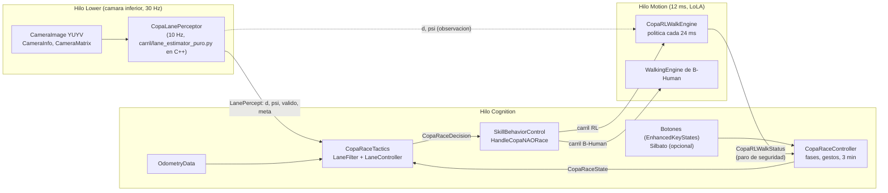

# Despliegue en el NAO real — 2. Plan e implementación

*2026-10-15. Claude Code, a pedido de Luis Mario (autor de PenaltyStack). Viene de la [auditoría](01_AUDITORIA.md).
Es la misma arquitectura del penal de PenaltyStack (`docs/robot/02_PLAN_E_IMPLEMENTACION.md` de la rama
`despliegue/copa-nao-ccm-2026`), con los módulos de la carrera.*

---

## 1. Plan (fase N2 del `PLAN.md`)

| Paso | Qué | Estado |
|---|---|---|
| 66b | Importar el framework B-Human 2023 (SabanaHerons2026 `2360ab1`) en `bhuman/` y compilarlo para el NAO V6 | `[x]` |
| 66c | Exportar las 6 políticas al formato de B-Human y portar a C++ contrato, política, visión, filtro y controlador, con paridad contra Python | `[x]` |
| 67b | Escenario `CopaNAORace`: visión, control de la carrera, táctica y marcha RL como módulos de `bhuman` | `[x]` |
| 68c | Herramientas de despliegue: `deployCopaRace`, `deploy/robot_deploy.py`, ventana `DeployCarreraNAO.bat` | `[x]` (simulacro) |
| 68d | Primera prueba en un NAO real, suspendido | `[ ]` (necesita el robot) |
| 68e | Revisión por el autor de PenaltyStack | `[ ]` |

## 2. Arquitectura a bordo

- **Un solo escenario, dos carriles.** El carril se elige al desplegar (`lane = rl | bhuman`) y se puede cambiar en
  el robot mientras espera (botón delantero 2 s). Así el mismo binario sirve para el RL y para el baseline 2 del
  paso 73.
- **Sin GameController.** `CopaRaceController` reemplaza a `GameStateProvider` y publica un `GameState` coherente
  (esperando = `waitForOwnKickOff`, corriendo = `playing`, al terminar `afterHalf`), para que el resto del framework
  (cabeza, `WhistleRecognizer`, sonidos) funcione sin cambios.

## 3. Núcleo portable: `bhuman/Src/Tools/CopaRace/CopaRace.h`

Todo el cálculo que tiene un equivalente en Python vive en un encabezado sin dependencias del framework, para
poder compararlo fuera del robot:

| En C++ (`namespace CopaRace`) | Original en Python |
|---|---|
| `armarObservacion`, `accionAObjetivos`, `objetivosASalida`, `rumboObjetivoInicial`, `EstadoCamara` | `src/race/contract.py` (contrato v1: 54 → 13, presupuesto lateral, rumbo objetivo del paso 58c) |
| `Politica` (MLP con normalización congelada; la acción determinista es `clip(media)`) | SB3 `model.predict(deterministic=True)` + `VecNormalize` |
| `EstimadorCarril` (incluye el modo "clara" y el modo "color") | `carril/lane_estimator_puro.py` |
| `PyRandom` (MT19937 con `init_by_array` y `_randbelow`) | `random.Random` de Python, para que el RANSAC sea idéntico |
| `LaneFilter`, `LaneController` | `carril/lane_filter.py`, `carril/controller.py` |

**Detalles que importan para la paridad exacta:**
- las sumas se hacen en el mismo orden que Python (`acc = gris[0]*(mitad+1) + tramo`, `x*(pi/180)` en vez de
  `x/180*pi`), porque la suma en coma flotante no es asociativa;
- la red se evalúa con los mismos redondeos a `float32` que numpy/torch.

### 3.1 Exportación de las políticas

`uv run python scripts/exportar_politicas_robot.py` escribe:

- `bhuman/Config/NeuralNets/CopaRace/<politica>.cfg`: pesos del actor, media y varianza de `VecNormalize`,
  `clipObs`, periodo de marcha y `vx_cmd` recomendado, en el formato de configuración de B-Human;
- `bhuman/Config/NeuralNets/CopaRace/politicas.json`: registro para la ventana (estado, `vx_cmd`, descripción,
  SHA-256 de cada `.cfg`);
- `tests/robot_paridad/carrera_golden.json`, `imagenes_carril.bin` e `imagenes_carril_modos.bin`: entradas y
  salidas del código Python para la prueba de paridad.

| Política | Estado | `vx_cmd` | SHA-256 del `.cfg` |
|---|---|---|---|
| `rl_v1.2.1` | recomendada | 0.45 | `2f3475f8…` |
| `rl_v1.2` | alternativa | 0.45 | `f87cf2ae…` |
| `rl_v1.1` | rápida (motores sobre el 80 %) | 0.45 | `1c2b546a…` |
| `rl_v1.0` | anterior | 0.40 | `b98c2335…` |
| `carrera_v02` | anterior | 0.40 | `7d9a8c86…` |
| `carrera_v01` | anterior | 0.40 | `79f8c9f1…` |

### 3.2 Prueba de paridad

`uv run python scripts/check_paridad_robot.py` compila `tests/robot_paridad/` (CMake de Visual Studio) y compara
el encabezado que corre en el NAO con lo que escribió Python:

- **políticas**: casos sacados de rollouts reales de `NaoRace-v0` para las 6 políticas, leyendo los mismos `.cfg`
  que se despliegan. **Diferencia máxima con SB3: 4.6 × 10⁻⁷** (tolerancia 2 × 10⁻⁴);
- **contrato** (observación, objetivos, ángulos, rumbo objetivo), **cámara simulada**, **azar** (MT19937), **filtro**
  y **controlador**: tolerancia 10⁻¹²;
- **visión**: 10 imágenes sintéticas de la pista normal (madera y cinta negra) y 6 de los otros dos modos (cinta
  blanca sobre piso oscuro y cinta verde sobre madera en modo color). Mismo `d`, `psi`, número de líneas y puntos,
  y la misma distancia a la meta, con tolerancia 10⁻¹²;
- **tiempo de inferencia en el PC**: ~65 µs por decisión (Ryzen 7 5800H, MSVC Release).

Resultado del 2026-10-15: `revisiones=19947 fallos=0`.

## 4. Módulos

### 4.1 `CopaLanePerceptor` (hilo Lower)

- Toma una imagen de la cámara inferior cada `periodMs` (100 ms = 10 FPS, como el entrenamiento), la pasa de YUYV
  a RGB a 320×240 y corre `EstimadorCarril` con la pose real de la cámara (`CameraMatrix`) y los intrínsecos
  calibrados (`CameraInfo`).
- Entrega `LanePercept`: `valid`, `d`, `psi`, `nLines`, `nPoints`, `quality`, `finishSeen`, `finishDistance`.
- **Colores:** `lightLine`, `colorMode`, `colorAxis` y `colorMean` los escribe el despliegue desde
  `config/pista_robot.json` (generado desde `config/pista.yaml`). Ningún color está en el código.

### 4.2 `CopaRaceController` (hilo Cognition)

Fases: `unstiff` → `waiting` → `running` → `finished` o `aborted` → `waiting` (rearmado).

| Gesto | Fase | Efecto | Dice |
|---|---|---|---|
| Toque al pecho | `unstiff` | Se pone de pie en la pose de salida | "learned walk ready" (RL) / "b human walk ready" |
| Botón delantero mantenido 2 s | `waiting` | Cambia el carril RL ↔ B-Human | "learned walk" / "b human walk" |
| **Toque al botón medio** | `waiting` | **Arranca** (fuente `headButton`) | — |
| Silbato (solo si `startMode` lo permite) | `waiting` | Arranca (fuente `refereeWhistle`); ignora silbatos de los primeros 2 s | — |
| **Pecho mantenido 0.3 s** o **botón trasero mantenido 0.5 s** | `running` | **Paro manual** → `aborted`, de pie | "stop" |
| (automático) meta, tope de distancia | `running` | `finished`, de pie | — |
| (automático) 3 minutos | `running` | `finished` | "time" |
| (automático) paro de seguridad de la marcha RL | `running` | `aborted` | "safety stop" |
| Toque al botón delantero | `finished` / `aborted` | Rearma | "learned walk ready" / "b human walk ready" |
| Los tres botones de la cabeza 1 s | cualquiera | Sin rigidez | "joints off" |

Cada cambio queda en el log del robot como `[CopaRace] t=… fase … -> …`, `arranque …` y `fin … tiempo=…`.

### 4.3 `CopaRaceTactics` (hilo Cognition)

- **Carril RL**: esperando, pide la pose `home` (`holdRL`); corriendo, la política (`runRL`). Al ver la meta roja a
  menos de `finishTrigger` (0.35 m), sigue `postFinish` (0.45 m) a `vx_cmd` y termina. Tope `rlMaxDistance` (7.5 m)
  estimado con `vx_cmd`.
- **Carril B-Human**: el `LaneFilter` (predicción con odometría + corrección con la visión) y el `LaneController`
  de Daniel dan un comando normalizado, que se escala con `bhumanMaxSpeed` (300 mm/s, 150 mm/s, 60 °/s) para
  `WalkAtAbsoluteSpeed`. Sin visión por más de 1.5 s baja la velocidad al 60 %. Termina al pasar la meta o a los
  6 m.

### 4.4 `CopaRLWalkEngine` (hilo Motion)

Provee `WalkAtRelativeSpeedGenerator`: cuando el comportamiento pide caminar en el carril RL, el MotionEngine
ejecuta su fase (`MotionPhase::calibration`, el tipo que no tiene casos especiales en el framework).

1. **Interpolación** (1.5 s): de la postura actual a `home` con un coseno.
2. **En `home`**: junta las `psi` válidas de la cámara; al recibir `runRL` y tras 0.5 s quieto, fija el rumbo
   objetivo con las `psi` de los últimos 0.5 s (paso 58c).
3. **Caminando**: cada 24 ms arma las 54 observaciones (velocidades articulares por diferencias finitas), evalúa la
   política y escribe los 26 ángulos con rigidez 100.

**Paros de seguridad** (se enclavan y avisan al controlador por `CopaRLWalkStatus`):
- inclinación `acos(cos roll · cos pitch)` > 0.6 rad mientras camina;
- temperatura de un motor de pierna ≥ 75 °C.

Al enclavarse, el generador entrega la postura de pie de B-Human y el robot dice "safety stop".

### 4.5 Comportamiento: `HandleCopaNAORace`

Traduce `CopaRaceDecision` a skills de B-Human: `idle` → sin rigidez; `holdRL`/`runRL` → `WalkAtRelativeSpeed`
(atendido por `CopaRLWalkEngine`); `runBHuman` → cabeza al frente + `WalkAtAbsoluteSpeed`; si no, de pie.

## 5. Escenario `CopaNAORace`

`bhuman/Config/Scenarios/CopaNAORace/` (derivado de `Default`):

| Archivo | Qué fija |
|---|---|
| `threads.cfg` | Proveedores: `LanePercept` → `CopaLanePerceptor`; `GameState` y `CopaRaceState` → `CopaRaceController`; `CopaRaceDecision` → `CopaRaceTactics`; `WalkAtRelativeSpeedGenerator` y `CopaRLWalkStatus` → `CopaRLWalkEngine`. Sin detectores de pelota |
| `copaRaceController.cfg` | Carril, modo de arranque, 3 min, tiempos de los gestos |
| `copaRaceTactics.cfg` | Meta, topes de distancia, velocidad del carril B-Human |
| `copaRLWalkEngine.cfg` | Política, `vx_cmd`, interpolación, paros de seguridad |
| `copaLanePerceptor.cfg` | Parámetros de la visión (los de Python) y los colores que escribe el despliegue |
| `skillBehaviorControl.cfg` | Opciones `HandlePhysicalRobot` y `HandleCopaNAORace` |
| `whistleRecognizer.cfg`, `strategyBehaviorControl.cfg` | Silbato sin silenciar; sin estrategia de fútbol |

Los 14 `threads.cfg` del framework llevan `CopaRaceDecision` y `CopaRaceState` en `defaultRepresentations`, para
que los demás escenarios sigan compilando y arrancando igual que antes.

## 6. Originales de B-Human modificados

`uv run python scripts/compilar_bhuman.py --check-originals` compara con `bhuman/PROVENANCE.json`:

- **15 originales modificados**: los 14 `Config/Scenarios/*/threads.cfg` (dos representaciones por defecto) y
  `SkillBehaviorControl.h` (incluye la opción y requiere las dos representaciones);
- **30 archivos nuevos**: los módulos, representaciones, núcleo, escenario, políticas y `deployCopaRace`;
- **0 originales faltantes**.

## 7. Herramientas

| Herramienta | Qué hace |
|---|---|
| `scripts/importar_framework_bhuman.py` | Importa el subconjunto del framework (4994 archivos) con su SHA-256 en `bhuman/PROVENANCE.json` |
| `scripts/compilar_bhuman.py` | Copia `bhuman/` a ext4 en WSL (`~/.cache/nao-race/bhuman`) y compila con el toolchain del NAO. `--install-toolchain` lo instala sin `sudo` (el mismo de PenaltyStack); `--check` lo revisa |
| `scripts/check_grafo_modulos.py` | Revisa sin robot que cada representación tenga proveedor y que las configuraciones tengan todos los parámetros |
| `scripts/check_paridad_robot.py` | Prueba de paridad (sección 3.2) |
| `bhuman/Make/Common/deployCopaRace` | Despliega en un robot: copia de preparación por robot, Wi-Fi apagado, manifiesto `carrera_deploy.json`, verificación del hash |
| `deploy/robot_deploy.py` | Línea de comandos: `--list`, `--ping`, `--deploy robot[:rl|bhuman]`, `--status`, `--start`, `--stop`, `--logs` |
| `deploy/deploy_dialog.py` y `DeployCarreraNAO.bat` | La ventana de despliegue |

## 8. Verificación (2026-10-15)

| Prueba | Resultado |
|---|---|
| Compilación Release para el NAO V6 | Sin errores ni advertencias en el código nuevo; binario sha256 `94766ce0…` |
| `check_grafo_modulos.py` | `CopaNAORace/Default: 136 modulos, 0 errores` (y `Default` sigue en 0) |
| `check_paridad_robot.py` | `revisiones=19947 fallos=0`; `max |accion C++ - SB3| = 4.55911e-07` |
| Despliegue en simulacro (2 robots en paralelo, carril RL y carril B-Human, `vx_cmd` propio y de la política) | `DEPLOY_OK` en los dos, con la configuración esperada en cada robot |
| Simulacro con `config/pista_robot.json` en modo color | `colorMode = true` con los mismos `colorAxis` y `colorMean` |
| Ventana de despliegue | Abre, comprueba conexión, valida el escenario y despliega en simulacro |

**Falta** (necesita el robot): pasos 68d y 69–74.
