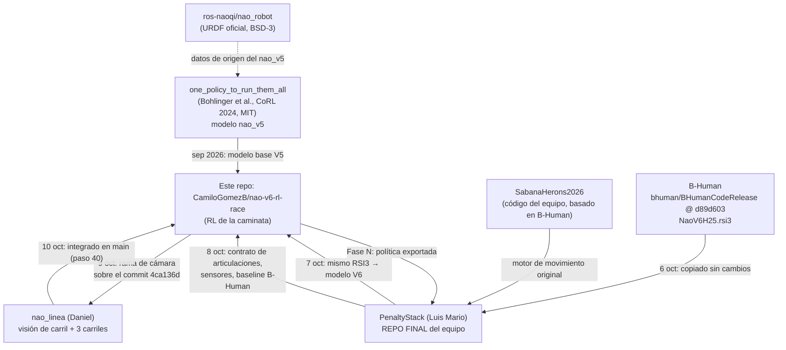

# Fuentes y repositorios: de dónde sale cada pieza

Este documento explica, para el paper, **todo lo que este repo tomó de otros lados**:
- qué es cada fuente y cómo funciona;
- qué se tomó exactamente (archivo, commit o SHA-256);
- **por qué** se usa;
- qué se le cambió.

Todo lo que aparece aquí fue **verificado** contra el historial de Git y los archivos de cada repositorio el
2026-10-10. Lo que no quedó registrado se dice explícitamente.

---

## 1. Mapa general

---

## 2. Modelo del robot

### 2.1 one_policy_to_run_them_all, la base del modelo V5 (septiembre)

- **Qué es:** repositorio del trabajo *One Policy to Run Them All: an End-to-end Learning Approach to
  Multi-Embodiment Locomotion* (N. Bohlinger et al., CoRL 2024). Entrena una sola política de locomoción
  para muchos robots y trae modelos MuJoCo de cada uno, entre ellos un NAO V5.
- **Qué se tomó:** `environments/nao_v5/data/nao.xml`, commit `7c1819444028c529b0a964fe3f32878333b1310a`
  (2025-05-15). Licencia **MIT**.
- **De dónde salen sus datos:** las posiciones, ejes, rangos, masas e inercias vienen del URDF oficial de
  Aldebaran publicado en [ros-naoqi/nao_robot](https://github.com/ros-naoqi/nao_robot) (BSD-3).
- **Por qué:** en el sprint de 48 h era un modelo MuJoCo del NAO listo, con licencia permisiva y probado en
  aprendizaje de locomoción.
- **Qué se le cambió** (detalle en `assets/nao/SOURCE.md`):
  - las mallas se reemplazaron por primitivas, por licencia (E02);
  - sin dedos;
  - HipYawPitch acoplado como en el robot real;
  - **ejes corregidos** a la convención de NAOqi, porque el original los invertía (E01);
  - muñecas fijas;
  - autocolisiones (E04);
  - servos de posición.
- **Estado:** reemplazado por el modelo V6 el 7 de octubre, porque la evaluación lo rechazó por ser una
  aproximación del V5 (E12). Con él se entrenó la política del sprint (`checkpoints/best_model.zip`), que
  sigue siendo la referencia "RL" en los 3 carriles.

### 2.2 URDF oficial V6 de Aldebaran (investigado, no usado)

- **Qué se encontró (30 de septiembre):**
  - `NAOH25V60.urdf`, publicado por personal de Aldebaran en el grupo `ros-sig-aldebaran` (2022);
  - las mallas V6 del SDK NAOqi 2.8.7.4, en [aldebaran/nao6-doc-sdk](https://github.com/aldebaran/nao6-doc-sdk).
- **Diferencia V5 → V6:** solo cambia la cabeza. La masa de la cabeza pasa de 0.605 a 0.660 kg y la total
  de 5.305 a 5.360 kg.
- **Estado:** el plan de los pasos 34–35 apuntaba a este URDF, pero el modelo V6 se terminó generando desde
  el RSI3 de B-Human (2.3). **El motivo del cambio no quedó registrado.**

### 2.3 B-Human y su NaoV6H25.rsi3, el modelo V6 actual (desde el 7 de octubre)

- **Qué es B-Human:** equipo de RoboCup *Standard Platform League* de la Universidad de Bremen y el DFKI
  (Alemania), varias veces campeón. Publica casi todo su software en
  [bhuman/BHumanCodeRelease](https://github.com/bhuman/BHumanCodeRelease) para que otros equipos lo usen.
- **Qué es el archivo RSI3:**
  - es la descripción de escenas de **SimRobot**, el simulador de B-Human, en XML;
  - `NaoV6H25.rsi3` describe el NAO V6 completo: 25 cuerpos, 24 articulaciones con ejes y límites, masas e
    inercias, primitivas de colisión, mallas visuales y parámetros de los servos (P, D y fuerza máxima);
  - el SimRobotCore3 de B-Human usa **MuJoCo** como motor físico.
- **Qué se tomó:**
  - el archivo **sin modificar**, `Config/Scenes/Includes/NaoV6H25.rsi3` de BHumanCodeRelease, revisión
    `d89d603f0388208cecd1c3144b6e8eb92aef4a93`, con SHA-256 `73f8c9a7…0981369`;
  - su `License.md`.

  Están en `assets/nao/bhuman/`.
- **Cómo llegó a este repo:**
  - PenaltyStack lo copió el **6 de octubre** (commit `21dbb16`, Luis Mario);
  - este repo lo agregó el **7 de octubre** (commit `d9207ec`) con **exactamente el mismo SHA-256**.

  Es decir, llegó por PenaltyStack.
- **Cómo se convierte:**
  - `scripts/build_nao_v6.py` es un script **propio** de este repo;
  - PenaltyStack tiene otro, `tools/build_bhuman_model.py`, con el mismo enfoque;
  - lee el RSI3, verifica el SHA-256 y genera `assets/nao/nao.xml` y las mallas `.obj`;
  - conserva cuerpos, ejes, rangos, masas, inercias, colisiones y servos;
  - agrega lo que necesita el RL: la pose `home`, los sitios de los pies, la IMU, las exclusiones de
    contacto y los grupos de colisión.
- **Por qué se usa:**
  1. Es una descripción del V6 completa y mantenida por un equipo que la usa en competencia.
  2. Es **el mismo archivo que usa PenaltyStack**, el repo final: los dos repos simulan exactamente el mismo
     robot y no hay que convertir nada al integrar.
  3. B-Human ya lo simula con MuJoCo.
- **Licencia:** la de B-Human permite redistribuir con aviso, con condiciones para el uso en RoboCup.
- **Pendiente:** validar la física del modelo generado (paso 44). Los valores heredados del modelo V5 siguen
  en el código (E16, paso 46).

---

## 3. PenaltyStack, el repo final del equipo

- **Qué es:** [Limao0521/PenaltyStack](https://github.com/Limao0521/PenaltyStack), de Luis Mario Ramírez Muñoz.
  Es un "mini stack" para la prueba de **penales** con NAO V6. Se analizaron la rama `feat/bhuman-simulation`
  (commit `9c08a41`) y la rama `feat/rl-contracts` (commit `9682fe0`).
- **De dónde viene:** de **SabanaHerons2026** ([juanulloa2050/SabanaHerons2026](https://github.com/juanulloa2050/SabanaHerons2026),
  revisión `2360ab11…`), el código del equipo basado en B-Human. De ahí conserva **sin modificar** 559
  archivos del motor de movimiento de B-Human, verificados por hash.
- **Cómo funciona:**
  - **En simulación:** MuJoCo con el mismo modelo V6. El movimiento lo produce el **motor original de B-Human
    en C++**: MotionEngine, **WalkingEngine**, KickEngine y otros. Se compila para Windows
    (`bhuman_motion.exe`) y se comunica por mensajes JSONL. La física avanza cada 2 ms y el motor cada 12 ms.
  - **En el robot:** un paquete Python 2.7 para NAOqi 2.8, sin MuJoCo:
    - lee los sensores de ALMemory;
    - arranca con el táctil frontal de la cabeza (0.25 s) y para con el botón del pecho (0.3 s);
    - camina con `ALMotion.moveToward`;
    - se despliega por Ethernet.
- **Por qué lo usamos:** es el **repo final**. La política de caminata de este repo tiene que poder
  integrarse ahí y funcionar.
- **Qué se tomó** (solo lo que sirve para caminar; nada de penales):
  - copia exacta de `penalty/motion_contract.py` en `third_party/penaltystack/`: orden de las 26
    articulaciones y ciclo de 12 ms;
  - como **datos**, no código (`docs/integracion_penaltystack.md`):
    - formato de los sensores, con las posiciones de los 8 FSR;
    - teclas de arranque y paro;
    - mecanismo de despliegue;
    - parámetros del WalkingEngine de B-Human (300 mm/s, pasos de 250 ms, cadera a 230 mm, pie a 13 mm),
      que dan **~18.7 s teóricos en 5 m**;
  - **la baseline 2**, la caminata de B-Human, confirmada por su autor el 2026-10-08.
- **Decisión del 2026-10-08:** al principio se copiaron también archivos de penales. El usuario indicó que
  **solo se usa lo de la caminata**, así que se borraron y quedó solo el contrato de articulaciones.

---

## 4. nao_linea: la visión de carril, que salió de este repo

- **Qué es:** [danielpaya/nao_linea](https://github.com/danielpaya/nao_linea), de Daniel. Contiene:
  - la **visión de carril**: el NAO ve las líneas con su cámara inferior y calcula dónde está;
  - la **pista de la carrera en MuJoCo**, con colores configurables;
  - las **caminatas de los dos baselines** y la **carrera de 3 carriles**;
  - un kit para probar la visión en el NAO real.
- **Origen: salió de este repo.** La cronología, verificada con Git:
  1. **9 de octubre, 21:06–21:57.** Daniel, con Claude, creó la rama `fase-p-camara-carril` **en este
     repo**, sobre nuestro commit `4ca136d` (paso 39). Era una propuesta para el paso de la cámara del plan
     de entonces ("Paso 70: definir el método de cámara"), con `camara/`, `docs/fase_p_camara.md` y
     `results/camara/`.
  2. **9 de octubre, 21:47–22:11.** La sacó como un apartado a su propio repo, `nao_linea`. Copió **sin
     cambios** nuestro `src/`, `checkpoints/` (la política del sprint) y `assets/` (el modelo V6); lo
     verificamos byte a byte. La rama original quedó guardada dentro de nao_linea como `.bundle` y `.zip`.
  3. **10 de octubre, 00:11.** Agregó las caminatas tipo NAOqi y tipo B-Human y la carrera de 3 carriles.
  4. **10 de octubre, 22:12.** Se **integró de vuelta en `main`** de este repo (paso 40), sin usar la rama:
     el usuario indicó que la rama había sido un error y que todo va en `main`.
- **Para qué se hizo la cámara:** la política de RL mantiene el rumbo con la IMU, pero la IMU no ve el carril.
  - Si el operador coloca el robot **3° chueco**, en 5 m se desvía **26 cm**, casi todo el margen.
  - En simulación, solo RL llegó en 3 de 18 corridas y RL + visión en 18 de 18.
  - Salirse del carril **anula la carrera**.
- **Cómo funciona la cámara:**
  1. busca la cinta en la imagen de la cámara inferior (QVGA, 10 FPS);
  2. filtra por el ancho de la cinta;
  3. proyecta al piso;
  4. ajusta las rectas con RANSAC;
  5. devuelve `d` (distancia al centro del carril), `psi` (ángulo respecto a las líneas) y si la medición
     es válida.

  Error típico: 1.6 cm y 1.2°. Hay versión en Python puro para el NAO. Detalle completo en
  [`vision_carril.md`](vision_carril.md).
- **Cómo funcionan las caminatas de los baselines** (`demo/caminatas/`). Son **reimplementaciones propias del
  esquema** de cada caminata, no el código original:
  - **Tipo NAOqi (baseline 1):**
    - pasos planeados con un péndulo invertido lineal y control *preview* del ZMP, que es el esquema que
      documenta Aldebaran para ALMotion;
    - con sus límites por defecto (`MaxStepX` 0.04 m, pasos de ~500 ms);
    - ~0.1 m/s.
  - **Tipo B-Human (baseline 2):**
    - el esquema *Walk2014* de rUNSWift, que B-Human usa desde 2018;
    - pasos de 250 ms y levantamiento del pie de 13 mm;
    - cambio de apoyo por los FSR y equilibrio con el giroscopio;
    - ~0.3 m/s, con los parámetros que publica B-Human y que coinciden con la config de PenaltyStack.

  Las dos reciben solo sensores del NAO real y se mandan con velocidad y giro, como `moveToward`.
- **Qué se cambió al integrarlo** (pasos 40 y 48):
  - archivos indebidos fuera (E20);
  - resultados movidos a `results/`;
  - **cada robot usa su cámara renderizada** en los 3 carriles; antes era visión simulada;
  - colores por robot;
  - meta en los 3 carriles;
  - visor con la GPU NVIDIA (E30–E32);
  - **colores de la pista en un solo archivo**, con el **modo de visión por color** (E24, E25);
  - `scripts/check_vision.py` y `scripts/cambiar_colores.py`.

---

## 5. Otras referencias

| Fuente | Para qué se usó |
|---|---|
| *Reglamento Copa NAO CCM MX 2026 V1.0* (PDF del comité organizador) | Reglas de la Carrera Individual (sección 3.2): carril, faltas, arranque y paro, colores |
| Roadmap técnico del director (3 semanas, 4 integrantes) | Organización general. Este repo solo cubre la parte de la carrera |
| Documentación de ALMotion (NAOqi 2.8) | Esquema y parámetros de la réplica tipo NAOqi |
| rUNSWift *Walk2014* / B-Human | Esquema de la réplica tipo B-Human |
| [Curso de Deep RL de Hugging Face](https://huggingface.co/learn/deep-rl-course), documentación de SB3 y Gymnasium | Conceptos usados en `docs/variables_rl.md` |

**Software, con las versiones fijadas en `uv.lock`:**
- Python 3.12;
- MuJoCo 3.14.0;
- Gymnasium 1.3.0;
- Stable-Baselines3 2.9.0;
- PyTorch 2.14.0 (CPU).

---

## 6. Tabla de procedencia de archivos

| En este repo | Origen | Versión / verificación | Licencia |
|---|---|---|---|
| `assets/nao/bhuman/NaoV6H25.rsi3` | BHumanCodeRelease, `Config/Scenes/Includes/` (vía PenaltyStack) | `d89d603`, SHA-256 `73f8c9a7…` | B-Human |
| `assets/nao/nao.xml`, `assets/nao/meshes/` | Generados por `scripts/build_nao_v6.py` desde el RSI3 | Reproducible | B-Human (derivado) |
| `third_party/penaltystack/motion_contract.py` | PenaltyStack, `penalty/motion_contract.py` | `9c08a41`, copia exacta | Uso autorizado por el equipo |
| `src/race/contract.py`: `PERIODO_MARCHA_S = 0.5` y la verificación de la altura de cadera de `home` (paso 46) | Parámetros del WalkingEngine de B-Human (`baseWalkPeriod` 250 ms, `walkHipHeight` 230 mm) en `baseline/bhuman/Config/Robots/Default/walkingEngineCommon.cfg` de PenaltyStack | `9c08a41`; se usan como **referencia**, no se copia código | B-Human |
| `src/race/contract.py`: `JOINT_NAMES_BHUMAN` y `CICLO_S` (paso 41) | Los mismos datos de `motion_contract.py` de PenaltyStack. El resto del contrato es propio. Formato del `frame` según el `SensorAdapter` de PenaltyStack | `9c08a41`; `scripts/check_contract.py` compara los nombres con la copia | Uso autorizado por el equipo |
| `carril/`, `demo/`, `robot/` | nao_linea | `f8e0cc6`, con los cambios de los pasos 40 y 48 | Del equipo |
| `assets/nao/scene_carril.xml`, `nao_cam.xml`, `duela.png` | Generados por `demo/build_scene.py` (de nao_linea) | Reproducible desde `config/pista.yaml` | Del equipo |
| `results/camara/modelo_error.md`, `lazo_cerrado.md` | nao_linea | `f8e0cc6` | Del equipo |
| `checkpoints/best_model.zip` | Este repo, sprint inicial (V2 brazos) | Entrenado en el modelo V5 | Del equipo |
| Modelo V5 (histórico, reemplazado) | one_policy_to_run_them_all `nao_v5` | `7c18194` | MIT |
