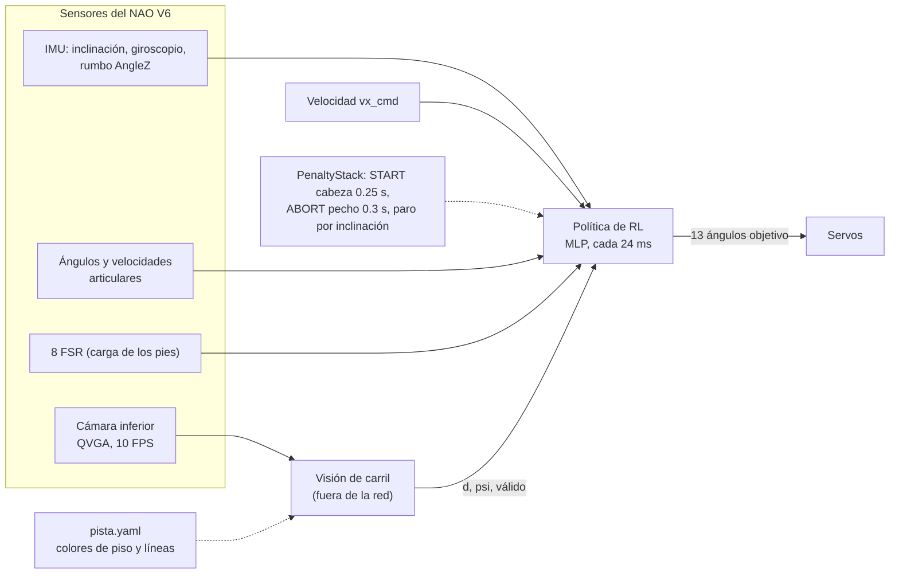

# Plan del sistema de RL para la Carrera Individual — Copa NAO CCM MX 2026

Este documento explica **cómo va a funcionar** la caminata por RL del NAO para la carrera:
- qué pide el reglamento y cómo pesa cada falta en el RL;
- contra qué caminatas nos comparamos (los **tres carriles**);
- qué recibe y qué controla la política, incluida la **cámara**;
- con qué **pesos** se recompensa;
- cómo se entrena con **distintas fricciones** y con **100 agentes** en paralelo;
- cómo se cambian los **colores de la pista** antes de la competencia sin complicaciones;
- cómo se integrará en el repo final, PenaltyStack.

Es la referencia para presentar el proyecto y la base del paper.

- Pasos concretos y estado: [`PLAN.md`](../PLAN.md).
- Historial, fallos y soluciones: [`bitacora.md`](bitacora.md).
- Condiciones del repo final: [`integracion_penaltystack.md`](integracion_penaltystack.md).
- **(a validar)** marca decisiones que dependen de mediciones. Si cambian, se actualiza este documento y
  se explica el motivo en la bitácora.

---

## Resumen para presentar

1. **Objetivo:** que el NAO V6 recorra el carril de 5 m × 70 cm **más rápido que las caminatas de B-Human y
   de NAOqi**, sin salirse del carril y sin caer.
2. **Tres carriles de comparación:**

   | Carril | Caminata | Qué se espera |
   |---|---|---|
   | 1 | **Baseline 1: NAOqi** (la de fábrica) | La más lenta, ~0.1 m/s |
   | 2 | **Baseline 2: B-Human** (la de PenaltyStack) | Rápida, ~0.3 m/s, ~16–19 s en 5 m |
   | 3 | **RL del equipo** | **La más rápida.** Meta: < 15 s en 5 m |

   Hoy, en simulación, el RL del sprint inicial va a 0.2 m/s (~24 s): todavía **pierde contra B-Human**.
3. **La política:**
   - **Observa** 54 valores medibles en el NAO. Incluyen la **cámara**: desplazamiento lateral `d`, ángulo
     respecto a las líneas `psi` y si la medición es válida.
   - **Controla** 13 articulaciones cada 24 ms.
4. **Las faltas del reglamento pesan más que cualquier ganancia de velocidad.**
   - Salirse del carril y caerse terminan el episodio con un castigo grande.
   - Chocar con otro robot descarta al agente en la selección.
   - La comunicación externa queda imposible por diseño.
5. **Fricción:** se entrena con fricciones aleatorias entre 0.4 y 1.2, distintas en cada pie. Se prueba
   en una batería fija de 5 valores.
6. **Colores de la pista:** están en **un solo archivo**. La política no ve colores, solo `d` y `psi`, así
   que cambiarlos no obliga a reentrenar.
7. **100 agentes:** desde una política base común, se entrenan 100 variantes con distintos pesos y
   fricciones. Se eliminan por rondas con la misma batería de pruebas y se queda la mejor.

---

## 1. Qué pide el reglamento y cómo lo trata el RL

Fuente: *Reglamento Copa NAO CCM MX 2026 V1.0*, sección 3.2 (Carrera Individual). Evento: **3 de
noviembre de 2026**, Tec de Monterrey campus Ciudad de México.

### 1.1 La pista y la prueba

| Regla | Valor | Consecuencia para el diseño |
|---|---|---|
| Carril | **5 m** × **70 cm** interior, líneas de 1.9 cm, sobre **duela de madera** | Margen lateral de ~±25 cm descontando el ancho de los pies |
| Colores | Hoy: líneas y salida **negras**, meta **roja**. **Los colores definitivos de líneas y piso se avisan poco antes del evento** | Todo lo que dependa del color va en un solo archivo (sección 10) |
| Clasificación | **Menor tiempo**; si no llega en 3 min, mayor distancia | Caer o salirse casi siempre pierde contra una marcha más lenta y segura |
| Salida | Ambos pies en la franja de salida, colocados a mano | Hay error de colocación de unos cm y grados: la cámara lo corrige |
| Meta | Franja de 30 cm; el tiempo para cuando un pie la pisa | No hace falta frenar |
| Activación | Por un sensor del NAO, ≤ **10 s** después del silbato | Táctil frontal de la cabeza 0.25 s, como en PenaltyStack |
| Paro manual | Obligatorio, con un sensor que **no esté en las piernas** | Botón del pecho 0.3 s, como en PenaltyStack |
| Robot | NAO de cualquier versión, sin modificaciones | **NAO V6 con NAOqi 2.8** |

### 1.2 Faltas y cómo pesan en el RL

Las faltas de la sección 3.2.6 no se pueden tratar como un detalle: **una sola falta pierde la carrera**.
Por eso cada una tiene un tratamiento explícito, en el entrenamiento, en la selección de agentes o en el
diseño del sistema.

| Falta (reglamento 3.2.6) | Sanción | En el entrenamiento (recompensa) | En la selección de agentes | En el diseño |
|---|---|---|---|---|
| **Salir del carril** (un pie pisa fuera de las líneas) | Retiro inmediato, carrera anulada | **Termina el episodio** con castigo grande (−300 desde el paso 55b; −200 al inicio) + **barrera** que castiga acercarse a la línea a menos de 10 cm | Una salida en la batería de pruebas = agente **descartado** | La cámara mide `d` y `psi` para corregir antes de llegar a la línea |
| **Provocar un choque contra otro robot** | **Descalificación del equipo** | Solo puede pasar **saliendo del carril**, así que la misma terminación lo previene antes. El valor de referencia es el doble que salir del carril (−400) | Se prueba con **robots vecinos** en los carriles de al lado (escena de 3 carriles). Un contacto = agente **descartado**, sin importar su tiempo | — |
| **Comunicación externa o control remoto** | Descalificación de la prueba | **No es un peso**: la política no tiene ninguna acción para comunicarse | — | **Imposible por diseño:** solo sensores propios, todo corre a bordo, sin Wi-Fi. Se verifica con la lista de chequeo del paso 76 |
| Caerse (no es falta, pero no llega) | Sin tiempo, se mide distancia | **Termina el episodio** con castigo (−100 inicial) | Una caída en la batería = agente **descartado** | Paro de seguridad por inclinación a bordo |
| Superar 3 minutos | Carrera no completada | Episodio de 30 s: más lento que eso ya no compite | — | — |
| Activar fuera de tiempo o antes del silbato | Descalificación (sección 2.9) | — | — | Arranque manual por táctil, ya resuelto en PenaltyStack |

**Por qué dos capas, recompensa y selección.** La recompensa le enseña a la política a evitar las
faltas. La selección **garantiza** que ninguna política que haya cometido una falta en las pruebas llegue
a la competencia, por rápida que sea.

---

## 2. Alcance: las piezas del sistema

| Pieza | Dónde vive | Qué hace |
|---|---|---|
| **Política de caminata (RL)** | Este repo (NAO) | Entrenamiento, evaluación y exportación |
| **Visión de carril (cámara)** | `carril/`, traída de [danielpaya/nao_linea](https://github.com/danielpaya/nao_linea) (Daniel) | Imagen de la cámara inferior → `d`, `psi`, válido a 10 Hz. Tiene versión en Python puro para el NAO |
| **Simulador de la pista** | `demo/build_scene.py`, de nao_linea | Escena MuJoCo del carril con la cámara inferior del NAO. **Es el MuJoCo que usa este repo** |
| **Benchmark de 3 carriles** | `demo/caminatas/`, de nao_linea | RL vs baseline 2 (tipo B-Human) vs baseline 1 (tipo NAOqi) en el mismo carril simulado |
| **App, arranque y paro, despliegue** | PenaltyStack (repo final) | Recibe la política y la visión |

Todas estas piezas se unifican en la rama `main` de este repo en el paso 40, y la versión final se lleva a
PenaltyStack en la Fase N.

---

## 3. Punto de partida: revisión de nao_linea (2026-10-10)

**Qué tiene, y funciona en simulación:**

1. **Visión de carril completa:**
   - busca la cinta por contraste local;
   - filtra por el ancho de la cinta;
   - proyecta al piso;
   - ajusta las rectas con RANSAC;
   - devuelve `d`, `psi`, válido y la distancia a la meta.

   **Precisión:** σ(d) = 1.6 cm y σ(psi) = 1.2°, con 1.5° de error en la pose de la cámara. Funciona con
   poca luz, reflejos y cinta gastada. Con un robot vecino tapando una línea sube a σ(d) = 4.8 cm.
2. **Versión en Python puro**, sin numpy y escrita compatible con Python 2.7. Tarda 13 ms por imagen en
   PC; en el NAO se estiman 40–110 ms, **a medir**.
3. **Lazo cerrado con la cámara renderizada en MuJoCo:**
   - solo RL: llega en **3 de 18** corridas;
   - RL + visión: llega en **18 de 18**, con desvío máximo de 14.5 cm.
4. **Pista con colores configurables** (`demo/pista.yaml`, hoy `config/pista.yaml`; 9 pisos y 7 colores de línea, o código hex). La
   visión decide sola si la línea es más oscura o más clara que el piso.
5. **Los tres carriles** (`demo/caminatas/carrera_vivo.py`, `benchmark.py`): B-Human a la izquierda, RL en el
   centro y NAOqi a la derecha. Cada robot va en su propia física y se ven juntos en el visor.
   - **Resultados que reporta**, con visión, 5 fricciones de 0.4 a 1.2 y error de colocación aleatorio:

     | Caminata | Velocidad | Tiempo en 5 m |
     |---|---|---|
     | Tipo B-Human | 0.30 m/s | 16.2–18.3 s |
     | RL actual | 0.20 m/s | 24.2–24.3 s |
     | Tipo NAOqi | 0.10 m/s | 45–50 s |

   - Ninguna se cae. Sin visión, las tres se salen en ~40 % de las corridas.
6. **Kit para el robot real** (`robot/`): diagnóstico, prueba en seco de la visión y guía paso a paso.

**Limitaciones que hay que tener en cuenta:**

- **Las caminatas de B-Human y NAOqi son reimplementaciones propias del esquema**, no el código original.
  Además, la velocidad la impone el comando: 0.30 y 0.12 m/s pedidos. Sirven para comparar en el mismo
  simulador, pero hay que contrastar la de B-Human con el **WalkingEngine original** que corre en
  PenaltyStack (paso 50). En el robot real se comparan las caminatas originales (paso 73).
- **El `benchmark.md` guardado en el repo es la versión corta** (12 corridas, una por celda). Las 150
  corridas que cita el README no están guardadas, así que hay que regenerarlas (paso 51).
- **La corrección del rumbo usa un truco:** le suma una señal falsa al giroscopio de la política. Con
  señales grandes se invierte. **La política nueva recibe `d` y `psi` como observación**, y eso reemplaza
  el truco.
- El RL usado es el del sprint inicial, entrenado en el modelo aproximado y sin fricción aleatoria.
- En el repo hay archivos que no deberían versionarse: `__pycache__`, `MUJOCO_LOG.TXT`, un `.bundle` y un
  `.zip`. Se limpian al integrar (paso 40).
- Los robots del benchmark no se tocan entre sí, porque cada uno va en su propia física. Por eso **el
  choque entre robots no se puede medir ahí**. Se agrega una escena de 3 carriles con física compartida
  (paso 48b), que usa el benchmark (paso 51).

---

## 4. Los tres carriles: qué comparamos y cómo

| Caminata | En simulación | En el robot real | Velocidad esperada |
|---|---|---|---|
| **Baseline 1: NAOqi** | Tipo NAOqi de nao_linea: ZMP + preview, pasos de 500 ms | `ALMotion.moveToward` de fábrica, con la misma corrección de visión | ~0.1 m/s |
| **Baseline 2: B-Human (PenaltyStack)** | Tipo B-Human de nao_linea, con los parámetros de la config de B-Human que trae PenaltyStack, **y** el WalkingEngine original en el simulador de PenaltyStack (para validar la réplica) | Framework de B-Human en el NAO | ~0.3 m/s (máx. de config 300 mm/s; ~18.7 s teóricos en 5 m) |
| **RL del equipo** | Nuestro entorno y el mismo carril del benchmark | Ejecutor a bordo con la política exportada | **Meta: ≥ 0.35 m/s de media, < 15 s en 5 m** |

**Protocolo común** (el mismo para las tres, para que la comparación sea justa):
- carril de 5 m con las medidas del reglamento;
- **las mismas** fricciones: μ = 0.4, 0.6, 0.8, 1.0, 1.2;
- **los mismos** errores de colocación, por semilla: σ = 2 cm y 2°, más casos extremos de ±10 cm y ±8°;
- con visión, que es como se corre, y sin visión, para medir la deriva propia;
- métricas:
  - tiempo en 5 m;
  - velocidad media;
  - desvío máximo;
  - rumbo máximo;
  - salidas;
  - caídas;
  - choques;
  - consistencia (desviación estándar).

---

## 5. Arquitectura con cámara

- **La cámara no entra como imagen a la red.** La visión corre aparte y le pasa 3 números a la política.
  Ventajas:
  - el entrenamiento no renderiza imágenes, así que sigue siendo rápido;
  - los colores de la pista no afectan a la red;
  - la visión se prueba sola con fotos reales.
- **La política decide cómo corregir.** Con `d` y `psi` aprende a volver al centro sin perder velocidad, en
  vez de recibir un giro calculado por un controlador externo.
- **Si la visión se pierde** (`válido = 0`), la política sigue con el rumbo de la IMU.

---

## 6. La política: observación, acción, comandos y recompensa (contrato v1)

### 6.1 Espacio de observación: 54 valores, solo sensores del NAO

> **En código:** [`src/race/contract.py`](../src/race/contract.py) (paso 41), compatible con Python 2.7 y sin numpy,
> para que la misma función arme la observación en el entrenamiento, en la demo y en el NAO a través de
> PenaltyStack. Prueba: `uv run python scripts/check_contract.py`.

| Componente | Dim | En simulación | En el NAO / PenaltyStack | Escala |
|---|---|---|---|---|
| Gravedad proyectada (inclinación del torso) | 3 | Orientación del torso | `InertialSensor/AngleX, AngleY` / `orientation` | — |
| Velocidad angular del torso | 3 | Sensor `gyro` | `InertialSensor/Gyr*` / `gyro` | ×0.25 |
| Error de rumbo de la IMU (respecto al rumbo de salida) | 1 | Rumbo real + deriva y ruido (sección 8) | `InertialSensor/AngleZ` | rad, recortado a ±π/2 |
| **`d`: desplazamiento lateral en el carril** | 1 | Real + **ruido gaussiano**, retardo y pérdidas (sección 7) | Visión de carril | m |
| **`psi`: ángulo respecto a las líneas** | 1 | Ídem | Visión de carril | rad |
| **`válido`: medición de cámara reciente (< 300 ms)** | 1 | Ídem | Visión de carril | 0/1 |
| Ángulos de las 13 articulaciones controladas (respecto a la pose de pie) | 13 | `qpos` | Encoders / `angles` | rad |
| Velocidades de esas articulaciones | 13 | `qvel` | Diferencia finita / `velocity` | ×0.05 |
| Acción anterior | 13 | Memoria | Memoria | [−1, 1] |
| Carga de cada pie (suma de sus 4 FSR / peso del robot) | 2 | Fuerzas de contacto | FSR / `fsr[8]` | 0–1 |
| Reloj de marcha (seno, coseno) | 2 | Software | Software | — |
| Comando de velocidad `vx_cmd` | 1 | Sorteado | Valor elegido para la carrera | m/s |
| **Total** | **54** | | | |

**No se observa nada que el robot no mida:** ni la velocidad lineal, ni la posición global, ni la altura.
Los colores tampoco: la política solo recibe lo que la visión ya calculó.

### 6.2 Espacio de acción: 13 ángulos objetivo cada 24 ms

**Cómo funciona la acción:**
- La acción es un vector en [−1, 1]. Se multiplica por la escala de cada articulación y se suma a la pose
  de pie.
- Los servos del modelo V6 siguen ese objetivo.
- La política actúa cada **24 ms**, es decir 2 ciclos de 12 ms, el ciclo de PenaltyStack y del NAO.

| Articulación | Escala (rad) | Para qué |
|---|---|---|
| HipYawPitch (un motor para ambas piernas) | ±0.10 **(a validar)** | Girar para **corregir el rumbo** |
| LHipRoll / RHipRoll | **Asimétrica:** hacia afuera 0.25, hacia adentro 0.07 | Pasar el peso **sin cruzar las piernas** (sección 12) |
| L/R HipPitch | ±0.5 | Largo del paso: más rango = más velocidad posible |
| L/R KneePitch | ±0.5 | Levantar el pie |
| L/R AnklePitch | ±0.4 | Despegue y apoyo |
| L/R AnkleRoll | ±0.25 | Equilibrio lateral |
| L/R ShoulderPitch | ±0.5 | Balanceo de brazos |
| Cabeza, resto de brazos | Fijos | La cabeza fija mantiene estable la pose de la cámara |

**Presupuesto lateral combinado** (paso 46). Los límites por articulación no bastan: con las dos caderas y los dos
tobillos hacia adentro a la vez, los pies se cruzan en el 2.2 % de las acciones al azar. Por eso:

- si la **suma** de lo que entran las dos piernas pasa de **0.09 rad** equivalentes de cadera, esas componentes se
  escalan;
- hacia afuera no hay presupuesto;
- los pesos salen de cuánto acerca los pies cada articulación en el V6:

  | Articulación | Acercamiento | Peso |
  |---|---|---|
  | HipRoll | 22.1 cm/rad | 1 |
  | AnkleRoll | 3.85 cm/rad | 0.17 |
  | HipYawPitch positivo | 10.6 cm/rad | 0.48 |
  | HipYawPitch negativo | 5.4 cm/rad | 0.24 |

**Resultado:** 0 cruces en 20,000 acciones al azar más todos los extremos (`scripts/check_valores_v6.py`).

### 6.3 Comandos

- **`vx_cmd`.** En entrenamiento se sortea en un rango que sube por currículo, hasta 0.5 m/s. En la carrera
  se usa la mayor velocidad que el robot real sostenga sin caer: es la **perilla de seguridad**.
- **El carril es el objetivo de rumbo.** `d = 0` y `psi = 0`. Ya no hace falta un "rumbo de salida"
  arbitrario: la cámara le dice al robot dónde está el centro del carril.

### 6.4 Recompensa: pesos iniciales y rangos para los 100 agentes

**Cómo funciona:**
- La recompensa puede usar información que el robot no mide: la `d`, la `psi` y la velocidad reales del
  simulador. Solo existe en el entrenamiento.
- La **columna de rango** es lo que explora el entrenamiento por población (sección 11).

| Grupo | Término | Qué mide | Peso inicial | Rango en el barrido |
|---|---|---|---|---|
| **Velocidad** | Seguimiento de `vx_cmd` | exp(−((vx − vx_cmd)/0.1)²) | **+1.0** | 0.5 – 2.0 |
| | Llegada a la meta | Bono único al pisar la franja de meta | **+20** | 0 – 50 |
| **Rectitud** | Rumbo respecto al carril | exp(−(psi/0.1)²) | **+0.5** | 0.2 – 1.0 |
| | Centrado | d² | **−2.0** | −0.5 a −5 |
| | **Barrera de margen** | ((0.10 − margen)/0.10)² cuando el pie está a menos de 10 cm de la línea | **−5.0** | −1 a −20 |
| | Velocidad lateral | vy² | −10 | −2 a −20 |
| | Velocidad de giro | ωz² | −0.5 | −0.1 a −2 |
| **Faltas** (terminan el episodio) | **Salida de carril** | Un pie toca la línea | **−300** (−200 hasta el paso 55b) | −300 a −400 (antes −50 a −400) |
| | **Choque con otro robot** | Referencia: el doble de una salida. En la práctica la salida lo previene antes; se mide en la selección | **−600** (−400 hasta el paso 55b) | 2 × salida |
| | **Caída** | Torso bajo, inclinado o una parte que no sea el pie toca el suelo | **−100** | −50 a −300 |
| **Estabilidad y robot real** | Patrón de marcha | Pies que coinciden con el reloj | +0.5 | 0 – 1.0 |
| | Vivo | Constante mientras no cae | +0.1 | fijo |
| | Inclinación del torso | gx² + gy² | −2.0 | −0.5 a −5 |
| | Altura del torso | (z − z_objetivo)², con z_objetivo del V6 | −50 | fijo |
| | Choque entre piernas | 1 si una pierna toca la otra | −1.0 | −0.5 a −5 |
| | Cambio de acción | ‖aₜ − aₜ₋₁‖² | −0.02 | −0.005 a −0.1 |
| | Torque | Σ τ² | −0.001 | fijo |
| | **Esfuerzo de los motores** (fase M2, desde `rl_v1.2`) | Σⱼ max(0, rⱼ − 0.75) / 0.75, con rⱼ = par RMS de ~1 s / par continuo del motor real (11 articulaciones de las piernas). Ver 6.9 | 0 hasta `rl_v1.1`; −0.5 a −2.0 en el barrido de esfuerzo | fijo por agente |

**Cómo elegir el tamaño de los castigos por falta.**
- **Muy chicos:** a la política le conviene arriesgar por velocidad, porque perder un episodio le cuesta
  poco.
- **Muy grandes:** la política se vuelve tímida y camina lento, porque cualquier riesgo es carísimo.

Terminar el episodio ya cuesta toda la recompensa futura, incluido el bono de meta. Los −200 y −100 son
el punto de partida, y el barrido de 100 agentes busca el equilibrio. La selección (sección 11.4)
garantiza que, sea cual sea el peso, ninguna política con faltas pase.

### 6.5 Episodio

- **Escena:** carril de 5 m × 70 cm, con la **fricción sorteada** (sección 9).
- **Inicio:** desde quieto, en la franja de salida, con error de colocación: ±10 cm y ±8° como máximo,
  normal con σ = 2 cm y 2°.
- **Antes de arrancar,** ~0.5 s de pie para que la visión mida dónde quedó el robot, como en la demo de
  nao_linea.
- **Fin:** caída, salida de carril o 30 s. El episodio sigue después de la meta para que la política no
  aprenda a frenar.
- **Cambios durante el episodio:** `vx_cmd` cambia de vez en cuando, y hay perturbaciones (sección 8).

### 6.6 Algoritmo

- **PPO** (Stable-Baselines3):
  - MLP con activación ELU;
  - 16 entornos en paralelo;
  - normalización de observaciones y recompensas;
  - semilla fija por agente.
- **Tamaño de la red:** 256×256 de partida. Se baja a 128×128 o 64×64 si la inferencia en Python 2.7 a bordo
  no cabe en los 24 ms, junto con la visión **(a medir en el paso 69)**.

### 6.7 Cómo llegan `d` y `psi` a la política (igual en entrenamiento, demo y robot)

**La regla de oro.** La política tiene que recibir **la misma señal** en los tres lugares:
- el entrenamiento, con la cámara simulada;
- el demo y la selección de agentes, con la cámara renderizada (`demo/caminatas/vision_camara.py`);
- el NAO real, con `robot/race_nao.py`.

Si la señal cambia de un lugar a otro, la política aprende con una y corre con otra. Ese es el camino más
corto a salirse del carril.

| Elemento | Convención |
|---|---|
| `d` | Distancia del robot (punto entre los pies) al **centro del carril**, en metros. **+ = robot a la izquierda del centro** |
| `psi` | Ángulo del robot respecto a las líneas, en radianes. **+ = robot girado a la izquierda** |
| `válido` | 1 si hubo una medición con al menos una línea en los últimos 300 ms; 0 si no |
| Frecuencia | Una medición nueva cada 100 ms (10 FPS de la cámara). Entre fotos se **mantiene** el último valor |
| Filtro | La política recibe la **última medición cruda**, sin filtrar, y aprende sola a promediar. El filtro de `VisionCamara` (α = 0.5) es solo para los baselines y la demo |
| Sin medición | Se mantiene el último valor y `válido = 0`. Al principio del episodio, `d = psi = 0` y `válido = 0` hasta la primera foto |

**Recompensa y selección usan los valores reales.** La recompensa (sección 6.4) usa la `d` y la `psi` reales
del simulador. La política solo ve las estimadas. La selección de agentes mide las faltas con la posición
real de los pies. Así una política no puede "engañar" a su propia visión.

### 6.8 Implementación: `NaoRace-v0` (pasos 53–58, 2026-10-11)

Código: [`src/envs/nao_race_env.py`](../src/envs/nao_race_env.py). Pruebas: `scripts/check_race_env.py` y
`scripts/check_camara_sim.py`. Los valores que el diseño no fijaba se eligieron así:

| Elemento | Implementación |
|---|---|
| Pista | Carril centrado en y = 0, salida en x = 0, meta en x = 5 m. Las líneas no son geometría: se mide con la posición real |
| Salida de carril | Una **esquina de la suela** pasa el borde interior de la línea (\|y\| > 0.35 m). Es más estricto que el benchmark, que usa el centro del pie + 4.5 cm |
| Meta | La punta de un pie llega a x ≥ 5 m: +20 una vez. El episodio sigue. `scripts/eval_carrera.py` mide el tiempo con el criterio del benchmark (centro de la suela) para comparar con B-Human |
| Inicio | Colocación normal de σ 2 cm / 2°, recortada a ±10 cm / ±8°. **0.5 s de pie dentro de `reset`**: la cámara mide y la política empieza con el reloj de marcha en 0 |
| Rumbo objetivo de la IMU | **Desde el paso 58c (E50):** la dirección del carril = rumbo de la IMU − `psi` medio de las fotos tomadas en los 0.5 s de pie (`contract.rumbo_objetivo_inicial`); sin fotos válidas, el rumbo de la IMU. Antes (v01, v02) era el rumbo con que arrancó el robot: si arrancaba torcido, la IMU le pedía mantener el ángulo equivocado |
| `vx_cmd` | Uniforme en [0.15, 0.5] m/s por episodio; en el 30 % cambia una vez entre 3 y 20 s |
| Carga de los pies | Fuerza normal pie-suelo / g / 5.36 kg, como la suma de los FSR, recortada a [0, 2] |
| Cámara simulada | Por episodio: σ_d U(1, 5) cm, σ_psi U(1, 4)°, retardo U(50, 250) ms, pérdidas U(0, 30) %, malas U(0, 8) % con hasta ±15 cm. Apagón de 0.5–2 s en el 30 % de los episodios |
| Pérdida de visión (desde `carrera_v02`) | 15 % de los episodios **sin cámara** (`sin_vision_prob`); apagones en el 60 % de los episodios, de 1–8 s y desde el arranque. Con la cámara casi siempre presente (`v01`), `válido = 0` quedaba fuera de distribución y la política se caía sin visión (E45) |
| Asimetrías | kp de los servos de cada pierna ×U(0.85, 1.15); calibración U(±1.5°) por articulación; centro de masa del torso ±1 cm; suelo inclinado ±1° (dirección de la gravedad) |
| Empujones | Cada 2–6 s, durante 50–150 ms: hasta ±6 N en x e y y ±0.4 N·m de giro en el torso |
| IMU y sensores | Deriva del rumbo de 0.003 rad/√s (paseo aleatorio) + ruido de 0.005 rad; giroscopio ±0.02 rad/s y ángulos ±0.002 rad (σ) |
| Rendimiento | 0.61 ms por paso (la física sola, 0.34 ms); ~2,400 pasos/s de PPO con 16 entornos |

En el robot real se hace igual: de pie, antes de tocar la cabeza, la cámara mide `psi`. Al arrancar, el rumbo objetivo
es el rumbo de la IMU menos ese `psi`. Así la IMU y la cámara apuntan al mismo lugar: el carril.

---

### 6.9 Esfuerzo de los motores: ninguna articulación por encima del 80 % (fase M2, 2026-10-13)

**Problema.** En simulación, `rl_v1.0` y `rl_v1.1` llevan rodillas y tobillos al 96–110 % del **par continuo** del
motor real: el par que el motor aguanta indefinidamente sin pasarse de temperatura (`results/riesgo_motores/`).
B-Human queda en 67–71 % y NAOqi en ≤ 61 %. Una carrera de 10 s no daña el motor, pero las prácticas acumulan calor.
**Decisión de Camilo:** `rl_v1.2`, más lenta si hace falta, con todas las articulaciones ≤ 80 %.

**La medida** (la misma de la gráfica "Calor" del dashboard):
- rⱼ = par RMS de la articulación j ÷ par continuo de su motor;
- par continuo en la articulación = par continuo del motor × reductora, sin la eficiencia del engranaje (cota
  superior). Tipo 5 (HipPitch, KneePitch, AnklePitch): 2.33 N·m. Tipo 1 (HipYawPitch, HipRoll, AnkleRoll):
  2.47 N·m. Valores en `src/race/valores_v6.py`;
- se mide en **cada paso de física de 2 ms**. Medir solo cada 12 ms se salta los picos de par que siguen a cada acción
  nueva (E56);
- los hombros no tienen dato del motor y quedan fuera del límite. Su par RMS es 0.36–0.41 N·m (B-Human 0.17); se
  revisa con el robot real.

**En el entrenamiento** (`NaoRace-v0`):
- media móvil de (par / par continuo)² con constante de tiempo de **1 s** (unos 2 ciclos de marcha);
- castigo `esfuerzo_motor` = Σⱼ max(0, √media − u) / u, con **u = 0.75**: margen sobre el 80 %, porque el par
  continuo y el modelo del servo tienen incertidumbre;
- el castigo es lineal, porque uno cuadrático casi no empuja cerca del umbral;
- **modo `instante`** (agregado tras la prueba del paso 62f): Σⱼ max(0, xⱼ − u²), con xⱼ = (par / par continuo)²
  medio de los últimos 24 ms. Es una señal inmediata para la política, y su media en la corrida es ≥
  Σ max(0, RMS² − u²), así que llevarlo a cero cumple el límite. Se elige con `modo_esfuerzo` del entorno;
- con `rl_v1.1` el castigo vale ~1.5 por paso, contra ~2 de recompensa positiva. Un peso mucho mayor que 1 puede
  dejar la recompensa por paso en negativo, y entonces caerse temprano "conviene" (el episodio dura 30 s): por eso el
  barrido usa pesos de −0.5 a −2.0.

**En la selección** (`scripts/barrido.py`, `puntaje`): una corrida con alguna articulación > 80 % es **falta**, igual
que una caída o una salida. Descarta al agente.

**Qué queda para después.** Esta primera versión es liviana y la decidió Camilo así: ajuste fino de `rl_v1.1`, solo
castigo, misma observación de 54 valores. Para un RL más pesado quedan:
- la corriente de los motores en la observación (contrato v2; el NAO la entrega por ALMemory);
- la temperatura para vigilar en el robot y un paro por temperatura;
- el límite de velocidad articular: las rodillas pasan la velocidad sin carga del motor el 1–9 % del tiempo.

## 7. Cámara simulada con ruido gaussiano

En el entrenamiento **no se renderizan imágenes**, porque sería unas 100 veces más lento. Se simula **la
salida de la visión**:

> `d`, `psi` = valor real del simulador + **ruido gaussiano** + retardo, actualizados a **10 Hz** y mantenidos
> entre fotos, con pérdidas (`válido = 0`) y mediciones malas ocasionales

**Valores nominales**, del modelo de error medido en nao_linea:

| Parámetro | Nominal | Rango de entrenamiento | Por qué el rango |
|---|---|---|---|
| σ de `d` | 1.6 cm | 1 – 5 cm | 4.8 cm con un robot vecino tapando; colores o luz peores |
| σ de `psi` | 1.2° | 1 – 4° | Ídem |
| Retardo | 100–200 ms | 50–250 ms | Tiempo de procesamiento a bordo sin medir |
| Pérdidas (`válido = 0`) | 5–10 % | 0–30 % | Colores poco contrastados, reflejos |
| Mediciones malas | 2–5 % con hasta ±15 cm | 0–8 % | — |

**Cómo se valida que la simulación de la cámara está bien:**
1. Los mejores agentes se prueban con la **cámara renderizada de verdad** y el estimador real de
   nao_linea, en lazo cerrado.
2. En el robot real se compara la visión con la cinta métrica (paso 70).

---

## 8. Caminar recto: pérdida de rectitud simulada

Aun con cámara, la política tiene que ir lo más recta posible por sí misma. Así necesita pocas
correcciones, aguanta si la visión se pierde un momento y no pierde velocidad corrigiendo. En
simulación se provocan las causas de desvío de un NAO real:

1. **Error de colocación inicial:** ±10 cm, ±8°.
2. **Asimetrías entre lados**, por episodio:
   - fricción distinta en cada pie;
   - ganancia de servos por pierna ±10–20 %;
   - error de calibración de ±1–2° por articulación;
   - centro de masa corrido;
   - holgura en tobillos y caderas.
3. **Perturbaciones:**
   - empujones de giro y laterales;
   - suelo con inclinación de ±1°.
4. **Deriva de la IMU:** el rumbo de `AngleZ` lleva ruido gaussiano + un sesgo que deriva lentamente.
5. **Pérdidas de visión:** tramos sin cámara en los que solo queda la IMU.

**Prueba de rectitud:** 100 episodios con todo lo anterior. Se mide la deriva **sin visión**, para la
calidad de la marcha, y el desvío **con visión**, para la carrera.

---

## 9. Fricción: entrenamiento y pruebas

**Situación actual.** El modelo usa μ = 1.0 en el piso y en los pies sin que nadie lo haya elegido: es el
valor por defecto de MuJoCo. MuJoCo usa el **mayor** de los dos, así que hay que fijarlo en ambos.

| Uso | Valores | Detalle |
|---|---|---|
| **Entrenamiento** | μ uniforme en **[0.4, 1.2]** por episodio, con hasta ±0.1 de diferencia entre los pies | Duela barnizada ~0.5–0.8, con margen hacia ambos lados |
| **Batería de pruebas** | μ = **0.4, 0.6, 0.8, 1.0, 1.2** | La misma que usa el benchmark de nao_linea, para comparar las 3 caminatas |
| **Robot real** | Medir μ de la duela con la prueba del plano inclinado: un pie del NAO sobre una tabla parecida, se inclina hasta que resbala y μ = tan(ángulo) | Paso 69. Centra el rango si hace falta |
| **Fricción torsional** | Probar `condim` 3 (hoy) contra 4 | El giro del pie sobre el suelo afecta la deriva de rumbo **(a validar)** |

En el barrido de 100 agentes, **el rango de fricción de entrenamiento también varía**: algunos agentes
entrenan con rangos estrechos y otros con rangos amplios. Todos se evalúan con la misma batería.

---

## 10. Colores de la pista: cambiarlos rápido antes de la competencia

**El problema.** Hoy las líneas son negras y la meta roja, pero **los colores definitivos de líneas y piso
se avisan poco antes del evento**. Cambiarlos no puede requerir tocar código ni reentrenar.

**La solución (implementada en el paso 48):**

1. **Un solo archivo,** [`config/pista.yaml`](../config/pista.yaml), con piso, veta, línea, salida y meta. Lo
   leen:
   - la escena de MuJoCo;
   - la demo;
   - el benchmark;
   - la verificación de la visión;
   - el robot, a través de `config/pista_robot.json`, que se genera solo.
2. **La política de RL no depende del color.** Solo recibe `d`, `psi` y válido. Un cambio de color solo
   afecta a la visión.
3. **La visión elige sola cómo ver la línea:**
   - **por brillo**, si es más oscura o más clara que el piso;
   - **por color**, si el brillo es parecido pero el color distinto: proyecta cada píxel sobre la dirección
     "línea − piso". Esto funciona igual en el estimador del NAO, en Python puro.
4. **La política se entrena con ruido de visión hasta 3 veces el nominal** (sección 7). Si con los colores
   nuevos la visión empeora, la política ya está preparada.
5. **Ya se sabe qué colores funcionan:** de 63 combinaciones de piso y línea, 57 dan OK en simulación
   ([`results/camara/matriz_colores.md`](../results/camara/matriz_colores.md)). Las que fallan son colores
   casi iguales.

**Procedimiento cuando nos avisen los colores** (paso 75, objetivo < 1 hora):
1. `uv run python scripts/cambiar_colores.py --piso <color> --linea <color>`. Guarda, regenera y verifica la
   visión en 50 posiciones; tarda menos de 1 minuto.
2. Si da `RESULTADO: OK`, **no se reentrena**. Si falla, ajustar la visión con fotos reales.
3. Copiar `config/pista_robot.json` al robot.
4. Correr la batería de pruebas de la política final con la pista nueva.
5. En la zona de calibraciones del evento (reglamento 2.10):
   - tomar fotos de la pista real;
   - ajustar los umbrales de la visión con `robot/replay.py`;
   - verificar `d` y `psi` con el robot quieto (`robot/race_nao.py --medir`).

**Limitación de la simulación:** la cámara simulada no tiene autoexposición. Con piso blanco la imagen se
satura a 255, y por eso falla, por ejemplo, la línea gris sobre blanco. La cámara real ajusta la exposición,
así que ese caso se verifica con fotos reales.

---

## 11. Entrenamiento por población: 100 agentes

**Idea.** En lugar de ajustar los pesos a mano uno por uno, se entrenan **100 agentes** con distintas
combinaciones de pesos, fricción y otros parámetros. Se evalúan todos con la **misma batería** y se
eliminan por rondas.

### 11.1 Qué varía entre agentes

Cada agente sortea su configuración dentro de los rangos de la sección 6.4:
- pesos de la recompensa;
- rango de fricción de entrenamiento: centro 0.5–1.0, ancho 0.2–0.8, asimetría entre pies 0–0.2;
- velocidad máxima del currículo: 0.35–0.5 m/s;
- período de marcha: 0.4–0.7 s (nominal 0.5 s, el de B-Human);
- multiplicador del ruido de la cámara: 1–3;
- semilla.

Cada configuración se guarda con el agente.

**Lo que realmente sortea `scripts/barrido.py` en la ronda 1 (paso 61, 2026-10-11).** Difiere de la lista de
arriba, que era el plan:
- **pesos:** uniforme dentro de `rangos` de `configs/carrera/pesos.yaml` (14 pesos; choque_robot = 2 × salida; vivo,
  altura y torque fijos);
- **fricción:** mínimo U(0.3, 0.5), máximo U(1.0, 1.3), con la asimetría de la base (0.1);
- **velocidad máxima pedida:** U(0.40, 0.60) m/s (rango de `vx_cmd` [0.15, máximo]);
- **ruido de la cámara:** σ_d máximo U(3, 6) cm y σ_psi máximo U(3, 5)°; apagones y episodios sin cámara, los de la
  base;
- **semilla** de PPO;
- **no se varía el período de marcha** (se queda en 0.5 s), porque la base ya está entrenada con ese reloj.

**Base:** `policies/carrera_v03` (hoy `policies/rl_v1.0`) con `configs/carrera_v03.yaml` (colocación amplia y rumbo `carril`).

**Batería corta, con visión y perturbaciones, `vx_cmd` 0.45:**
- μ 0.4, 0.6, 0.8, 1.0 y 1.2 × 2 semillas, con la colocación del benchmark;
- 4 salidas torcidas a μ 0.6: (+10 cm, +15°), (−10 cm, −15°), (0, +25°) y (0, −25°).

Puntaje: sección 11.4.

### 11.2 Base común y rondas

Entrenar 100 agentes desde cero es caro: cada uno tarda ~0.5M pasos solo en aprender a no caerse. Por eso:

1. **Base común** `carrera_v01`: un entrenamiento largo con los pesos iniciales y fricción aleatoria.
   Camina, cruza los 5 m y usa la cámara. **En la práctica** (2026-10-11), la base de la ronda 1 es `carrera_v03`: `v01` →
   `v02` (pérdida de visión) → `v03` (salidas torcidas).
2. **Ronda 1:** 100 agentes parten de la base y se ajustan ~1M pasos cada uno. Se evalúan con una batería
   corta y pasan los **20 mejores**.
3. **Ronda 2:** los 20 siguen ~5M pasos. Se evalúan con la batería completa y pasan los **5 mejores**.
4. **Ronda 3:** los 5 se entrenan con toda la domain randomization y se evalúan con la **cámara
   renderizada**, la **escena de 3 carriles con robots vecinos** y el benchmark contra B-Human y NAOqi.
   Queda **el campeón**.
5. Lo aprendido, es decir qué rangos ganaron, define la siguiente generación.

### 11.3 Costo estimado (a medir en el paso 43)

Todos los entrenamientos corren en **un solo PC**, la laptop Ryzen 7 5800H, a ~3,800 pasos/s. Por eso las
rondas son más cortas que si hubiera dos máquinas:

| Ronda | Pasos | Tiempo estimado |
|---|---|---|
| Ronda 1 | 100 × 1M | ~7.5 h (una noche) |
| Ronda 2 | 20 × 5M | ~7.5 h (una noche) |
| Ronda 3 | 5 × 20M | ~7.5 h (una noche) |

**Total:** unas 3 noches de cómputo, más la base común. Los agentes corren en cola, uno detrás de otro con
16 entornos cada uno, y la cola se puede reanudar si se interrumpe. Si no alcanza, se reducen pasos o
agentes (paso 65). La torre con RTX 5060 no está disponible por ahora.

### 11.4 Cómo se elige: puntaje de selección

1. **Filtro duro**, en este orden. Ninguna ganancia de velocidad compensa:
   - **cualquier choque con un robot vecino** → descartado (reglamento: descalifica al equipo);
   - **cualquier salida de carril** → descartado (anula la carrera);
   - **cualquier caída** → descartado.
2. **Entre los que pasan:** menor **tiempo medio en 5 m + 1 desviación estándar**. Premia ser rápido **y**
   consistente, porque hay un solo intento.
3. **Desempate:** menor desvío máximo.

---

## 12. Modelo V6: separación de piernas y valores heredados

**Qué cambió.**
- El V6 de B-Human usa las **cajas de colisión reales**: muslos y tibias de 7 cm de ancho y pies de 7.5 cm,
  con las caderas separadas 10 cm.
- En la pose de pie quedan **3.0 cm entre muslos y tibias y 3.1 cm entre pies** (medido el 2026-10-08).
- Un HipRoll hacia adentro de ~0.075 rad por pierna cierra ese espacio.
- La escala actual (±0.25 rad, simétrica) es del modelo aproximado.

**Valores que eran del modelo aproximado, ya resueltos en el paso 46.** Los valores nuevos están en
`src/race/contract.py` y `src/race/valores_v6.py`. El entorno del sprint, `src/envs/nao_walk_env.py`, conserva los
viejos, porque los usa la política del sprint en la demo.

| Valor | Antes (aproximado) | V6 (medido) | Cómo se obtuvo |
|---|---|---|---|
| Pose de pie `home` | cadera −0.4, rodilla 0.8, tobillo −0.4 | **Igual** | La cadera queda a 232 mm de la suela; B-Human camina con 230 mm |
| HipRoll | ±0.25, simétrico | **Afuera 0.25 / adentro 0.07 + presupuesto lateral de 0.09 rad** | Cruce de piernas: 23.9 % → 2.2 % → **0 %** de 20,000 acciones |
| HipYawPitch | Fija en 0 | **±0.10** (dentro del presupuesto) | Para girar con la cámara |
| Altura objetivo del torso | 0.31 m | **0.316 m** | De pie, asentado 2 s |
| Altura de caída | 0.22 m | **0.24 m** | Agachado al máximo = 291.6 mm; −5 cm de margen |
| Período de marcha | 0.6 s | **0.5 s** (barrido 0.4–0.7) | 2 pasos de 250 ms, como B-Human |
| Ciclo de control | 20 ms | **24 ms** (12 × 2 ms) | Ciclo de 12 ms de PenaltyStack ×2 |
| Fricción | 1.0 por defecto | Aleatoria [0.4, 1.2] | Paso 47 |
| Autocolisión entre piernas | Activada, sin castigo | Se castiga en la recompensa (sección 6.4) | Paso 55 |

**Caídas vistas en la demo interactiva.** Ocurren al pausar y reanudar: la política no sabe arrancar desde
quieto. En la carrera no se pausa, pero se arranca desde quieto. Por eso el episodio siempre arranca así
(paso 45 para el diagnóstico).

---

## 13. Del simulador al robot real

1. **Sesión 1, robot suspendido:**
   - Python, numpy y tiempo de inferencia a bordo;
   - tiempo de la visión;
   - respuesta de los servos;
   - ruido de IMU y FSR;
   - deriva de `AngleZ`;
   - **precisión de `d` y `psi` con cinta métrica**, que es el criterio pendiente de la cámara;
   - **μ de la duela**.
2. **Identificar los servos** y llevarlos al simulador.
3. **Primero dentro de PenaltyStack:** la política corre en su simulador junto a la caminata original de
   B-Human.
4. **A bordo:** ejecutor con la visión en Python puro y la política exportada, con START, ABORT, ciclo de
   24 ms y paro por inclinación.
5. **Pruebas escalonadas:** suspendido → arnés → 1 m → 5 m, con `vx_cmd` creciente.
6. **Comparación real de los tres carriles:** NAOqi, B-Human y RL en la misma pista réplica.

---

## 14. Métricas y protocolo

| Métrica | Simulación | Robot real |
|---|---|---|
| Tiempo en 5 m y velocidad media | ✓ | ✓ (cronómetro + video) |
| Salidas de carril, caídas, choques | ✓ | ✓ |
| Desvío máximo y rumbo máximo | ✓ | ✓ (video y cinta métrica) |
| Consistencia (desviación estándar) | ✓ | ✓ |
| Desempeño por fricción | ✓ (5 valores) | ✓ (duela medida) |
| Con y sin visión | ✓ | ✓ |

**Protocolo en simulación:**
- semillas fijas;
- acciones deterministas;
- la misma batería para las 3 caminatas y para los 100 agentes.

**Protocolo en el robot real:**
- pista réplica de 5 m;
- misma superficie y batería cargada;
- 5 o más corridas por caminata;
- video y log de cada corrida.

---

## 15. Riesgos y mitigación

| Riesgo | Mitigación |
|---|---|
| El RL no supera a B-Human | Currículo de velocidad, 100 agentes y rango de HipPitch; meta medida contra la misma batería |
| La visión falla con los colores definitivos | Un solo archivo de colores, visión que decide sola la polaridad, política entrenada con ruido hasta 3×, procedimiento de < 1 hora y zona de calibraciones |
| La fricción real es distinta a la simulada | Entrenamiento en [0.4, 1.2], batería de 5 valores, medición de la duela real |
| Salida del carril o choque con un robot vecino | Barrera de margen + terminación + filtro duro en la selección + escena de 3 carriles |
| Las piernas chocan en el V6 | HipRoll asimétrico, castigo por choque, diagnóstico (paso 45) |
| La red y la visión no caben en el tiempo a bordo | Medir en la sesión 1; red más chica; visión con numpy si existe |
| El cómputo de 100 agentes no alcanza en un solo PC | Base común + rondas cortas en cola nocturna; reducir pasos o agentes |
| No llegar a tiempo | Las caminatas de B-Human y NAOqi con visión ya llegan siempre en simulación: son el plan B |
