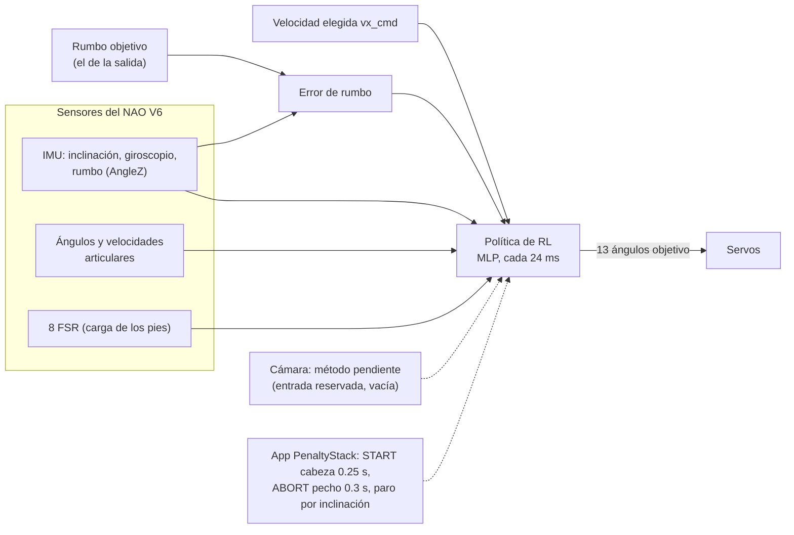

# Plan del sistema de RL para la Carrera Individual — Copa NAO CCM MX 2026

Este documento explica **cómo va a funcionar** la caminata por RL del NAO para la carrera:
- qué pide el reglamento;
- contra qué nos comparamos;
- qué recibe y qué controla la política: espacio de observación y espacio de acción;
- con qué pesos se recompensa;
- cómo aprende a caminar recto sin cámara;
- cómo se integrará en el repo final, PenaltyStack.

Es la referencia para presentar el proyecto y la base del paper.

- Pasos concretos y estado: [`PLAN.md`](../PLAN.md).
- Historial, fallos y soluciones: [`bitacora.md`](bitacora.md).
- Análisis del repo final y sus condiciones: [`integracion_penaltystack.md`](integracion_penaltystack.md).
- **(a validar)** marca decisiones que dependen de mediciones. Si cambian, se actualiza este documento y
  se explica el motivo en la bitácora.

---

## Resumen para presentar

1. **Objetivo:** que el NAO V6 recorra el carril de 5 m × 70 cm lo más rápido posible, **lo más recto
   posible** y sin caer.
2. **Alcance de este repo:** solo el **RL de la caminata**. La cámara y el resto de la app viven en
   **PenaltyStack**, el repo final, y la política se diseña para enchufarse ahí.
3. **Baseline:** la caminata ya establecida en PenaltyStack, el **WalkingEngine de B-Human**. Su tope
   teórico es de unos 18.7 s en 5 m a 300 mm/s. Cada política de RL se compara contra ella con el mismo
   protocolo.
4. **La política:**
   - **Observa** solo lo que el NAO mide: IMU, ángulos, velocidades, carga de los pies y error de rumbo.
     Son 51 números.
   - **Controla** 13 articulaciones: piernas, HipYawPitch para corregir el rumbo y hombros.
   - **Actúa** cada 24 ms.
5. **Caminar recto sin cámara:** en simulación se *provoca* que el robot se desvíe de varias formas:
   - asimetrías entre piernas;
   - empujones de giro;
   - error inicial;
   - estimación de rumbo con ruido gaussiano y deriva.

   Con eso la política aprende a corregirse sola.
6. **Cámara:** pendiente de definir. Cuando esté, se simulará su salida con **ruido gaussiano** y se
   agregará a la política. Ver la sección 7.

---

## 1. Qué pide el reglamento

Fuente: *Reglamento Copa NAO CCM MX 2026 V1.0*, sección 3.2 (Carrera Individual). Evento: **3 de
noviembre de 2026**, Tec de Monterrey campus Ciudad de México.

| Regla | Valor | Consecuencia para el diseño |
|---|---|---|
| Carril | **5 m** × **70 cm** interior, líneas negras de 1.9 cm, sobre **duela de madera** | Margen lateral de ~±30 cm descontando el ancho de los pies |
| Salir del carril (un pie pisa fuera) | **Carrera anulada** | Ir recto es tan importante como ir rápido |
| Clasificación | **Menor tiempo**; si no llega en 3 min, mayor distancia | Caerse casi siempre pierde contra una marcha más lenta y segura |
| Salida | Ambos pies en la franja de salida | El episodio empieza desde quieto |
| Meta | Franja roja; el tiempo para cuando un pie la pisa | No hace falta frenar |
| Activación | Por un sensor del NAO, ≤ **10 s** después del silbato | Táctil frontal de la cabeza sostenido 0.25 s, como en PenaltyStack |
| Paro manual | Obligatorio, con un sensor que **no esté en las piernas** | Botón del pecho sostenido 0.3 s, como en PenaltyStack |
| Comunicación | Sin control remoto ni Wi-Fi; carga por Ethernet antes | Todo corre **a bordo** |
| Robot | NAO de cualquier versión, sin modificaciones | **NAO V6 con NAOqi 2.8** |

El silbato **no** activa al robot: el operador lo escucha y toca el sensor. PenaltyStack no tiene
detector de silbato, y no hace falta. Ver [integración, sección 4](integracion_penaltystack.md#4-silbato).

---

## 2. Alcance: este repo y PenaltyStack

| | Este repo (NAO) | PenaltyStack (repo final) |
|---|---|---|
| Qué contiene | Entrenamiento, evaluación y exportación de la **política de caminata** | App completa: arranque y paro, sensores, cámara, despliegue en el NAO, simulador con el motor de B-Human |
| Modelo del robot | NAO V6 de B-Human (`NaoV6H25.rsi3`) | **El mismo archivo**, con el mismo SHA-256 |
| Qué entrega | Política exportada + módulo de inferencia + ejecutor compatible | Recibe la política y la ejecuta |

**Condiciones de PenaltyStack que respetamos desde el diseño**
([detalle](integracion_penaltystack.md#3-condiciones-que-impone-penaltystack-a-nuestra-política)):
- orden de articulaciones de B-Human;
- ciclo de 12 ms;
- sensores con su formato, incluidos los 8 FSR en kg;
- Python 2.7 a bordo, sin torch y quizá sin numpy;
- arranque y paro por táctil y botón;
- despliegue por Ethernet con `deploy/`.

---

## 3. Baseline: la caminata de PenaltyStack

El baseline es la caminata ya establecida en PenaltyStack, el **WalkingEngine original de B-Human**:

| Parámetro | Valor |
|---|---|
| Velocidad máxima hacia adelante | 300 mm/s (config del NAO) |
| Aceleración máxima | 75 mm/s² |
| Duración de un paso | 250 ms |
| Altura de cadera | 230 mm |
| Levantamiento del pie | 13 mm |
| Tiempo teórico en 5 m a 300 mm/s | **~18.7 s** (a medir) |

**Cómo se compara:**

| Dónde | Baseline | Política de RL | Protocolo |
|---|---|---|---|
| Simulación | WalkingEngine de B-Human en el simulador de PenaltyStack | Nuestra política, primero en nuestro entorno y después **dentro del simulador de PenaltyStack** | Mismo carril de 5 m, mismas semillas, 5+ corridas |
| Robot real | La caminata de B-Human corriendo en el NAO con el framework de B-Human (a confirmar en la sesión 1) | Nuestra política con el ejecutor a bordo | Misma pista marcada, superficie y batería, 5+ corridas |

**Métricas:**
- tiempo en 5 m;
- velocidad media;
- **deriva lateral al llegar**;
- **rumbo máximo**;
- caídas;
- salidas de carril;
- choques entre piernas, solo en simulación;
- consistencia entre corridas.

La política actual del sprint inicial (0.2 m/s, ~25 s en 5 m) queda como referencia histórica, no
como baseline.

---

## 4. Arquitectura

- **La política hace todo el trabajo de caminar y de mantener el rumbo.** Recibe el error entre el rumbo
  de salida y el rumbo actual, estimado por la IMU, y aprende a corregirlo con sus propias piernas.
- **La cámara queda como entrada reservada.** Su método todavía no está definido. Cuando lo esté,
  aportará lo que la IMU no puede medir: la posición lateral dentro del carril y el ángulo respecto a
  las líneas. Ver la sección 7.

---

## 5. La política: observación, acción, comandos y recompensa (contrato v1)

### 5.1 Espacio de observación: 51 valores, solo sensores reales

Cada fila dice de dónde sale el dato en entrenamiento y de dónde sale en el robot y en PenaltyStack.
Así se garantiza que la política se pueda pasar al robot.

| Componente | Dim | En simulación | En el NAO / PenaltyStack | Escala |
|---|---|---|---|---|
| Gravedad proyectada (inclinación del torso) | 3 | Orientación del torso | `InertialSensor/AngleX, AngleY` / `orientation` | — |
| Velocidad angular del torso | 3 | Sensor `gyro` | `InertialSensor/Gyr*` / `gyro` | ×0.25 |
| **Error de rumbo** (rumbo objetivo − rumbo estimado) | 1 | Rumbo real **+ modelo de error** (sección 6.4) | `InertialSensor/AngleZ` / yaw de `orientation` | rad, recortado a ±π/2 |
| Ángulos de las 13 articulaciones controladas (respecto a la pose de pie) | 13 | `qpos` | Encoders / `angles` | rad |
| Velocidades de esas articulaciones | 13 | `qvel` | Diferencia finita de ángulos en el NAO / `velocity` | ×0.05 |
| Acción anterior | 13 | Memoria | Memoria | [−1, 1] |
| Carga de cada pie (suma de sus 4 FSR / peso del robot) | 2 | Fuerzas de contacto, igual que el `SensorAdapter` de PenaltyStack | FSR / `fsr[8]` | 0–1 |
| Reloj de marcha (seno, coseno) | 2 | Software | Software | — |
| Comando de velocidad `vx_cmd` | 1 | Sorteado | Valor elegido para la carrera | m/s |
| **Total** | **51** | | | |

**Cambios respecto a la política anterior:**

| Dato | Cambio | Por qué |
|---|---|---|
| Velocidad lineal del torso | **Se quita** | El NAO no la mide |
| Contacto binario de los pies | **Se cambia** por carga en kg | Es lo que da el NAO |
| Error de rumbo | **Se agrega** | Es la base para ir recto |
| Comando de velocidad | **Se agrega** | Permite elegir la velocidad en la pista sin reentrenar |

**No se observa:** altura del torso, posición global, velocidad lineal ni posición lateral en el
carril. La posición lateral es justo lo que aportará la cámara.

**Reservado para la cámara (contrato v2, no implementado):**
- desplazamiento lateral en el carril;
- ángulo respecto a las líneas;
- un indicador de "medición válida".

Son 3 valores. Ver la sección 7.

### 5.2 Espacio de acción: 13 ángulos objetivo cada 24 ms

**Cómo funciona la acción:**
- La acción es un vector en [−1, 1]. Se multiplica por la escala de cada articulación y se suma a la
  pose de pie.
- Los servos de posición, con los parámetros del modelo V6, siguen ese objetivo.
- La política actúa cada **24 ms**, es decir 2 ciclos de 12 ms de PenaltyStack y del NAO, unos 41.7 Hz.
  La física corre a 2 ms. Ese período está **(a validar)** con el tiempo de inferencia a bordo.

| Articulación | Escala (rad) | Para qué |
|---|---|---|
| HipYawPitch (un solo motor para ambas piernas) | ±0.10 **(a validar)** | Girar el pie para **corregir el rumbo** |
| LHipRoll / RHipRoll | **Asimétrica:** hacia afuera hasta 0.25, hacia adentro solo hasta ~0.07 **(a validar)** | Pasar el peso de un pie a otro **sin cruzar las piernas** (ver sección 8) |
| L/R HipPitch | ±0.5 | Largo del paso |
| L/R KneePitch | ±0.5 | Levantar el pie |
| L/R AnklePitch | ±0.4 | Despegue y apoyo |
| L/R AnkleRoll | ±0.25 | Equilibrio lateral |
| L/R ShoulderPitch | ±0.5 | Balanceo de brazos, que compensa el giro del torso |
| Cabeza, resto de los brazos | Fijos en la pose de pie | — |

### 5.3 Comandos

- **`vx_cmd`, velocidad hacia adelante.** En entrenamiento se sortea en un rango que crece por
  currículo. En la carrera se usa la mayor velocidad que el robot real sostenga sin caer: es una
  **perilla de seguridad**.
- **Rumbo objetivo.** Es el rumbo con el que sale el robot, alineado con el carril. Más adelante la
  cámara podrá ajustarlo.

### 5.4 Recompensa: pesos iniciales (v1)

**Cómo funciona:**
- La recompensa **sí puede usar información que el robot no mide**, como la velocidad real, el rumbo
  real o la posición lateral, porque solo se calcula durante el entrenamiento. La política nunca la ve.
- Los pesos son el punto de partida. Cambiar uno es una nueva generación y se documenta.

| Término | Qué mide | Peso inicial | Viene de |
|---|---|---|---|
| Velocidad | exp(−((vx − vx_cmd)/0.1)²) | **+1.0** | Sprint inicial |
| **Rumbo** | exp(−(error de rumbo real/0.1)²) | **+0.5** | Nuevo |
| Patrón de marcha | Pies que coinciden con el reloj de marcha | +0.5 | Sprint inicial |
| Vivo | Constante mientras no cae | +0.1 | Sprint inicial |
| Inclinación del torso | gx² + gy² | −2.0 | Sprint inicial |
| Altura del torso | (z − z_objetivo)², con z_objetivo recalculado para el V6 | −50 | Sprint inicial (valor a actualizar) |
| Velocidad lateral | vy² | −10 | Sprint inicial |
| **Deriva lateral** | y², posición lateral respecto al centro del carril | **−1.0** | Nuevo |
| Velocidad de giro | ωz² | −0.5 | Sprint inicial |
| **Choque entre piernas** | 1 si una pierna toca la otra | **−1.0** | Nuevo (V6) |
| Cambio de acción | ‖aₜ − aₜ₋₁‖² | −0.02 | Sprint inicial |
| Torque | Σ τ² | −0.001 | Sprint inicial |
| Caída | Una vez, termina el episodio | −10 | Sprint inicial |
| **Salida de carril** | Un pie fuera de los 70 cm, termina el episodio | **−10** | Nuevo (reglamento) |

### 5.5 Episodio

- **Inicio:** desde quieto, con ambos pies en la franja de salida.
- **Variación inicial:**
  - pequeña variación de la pose;
  - **rumbo inicial desviado** ±5–10°;
  - posición lateral desviada ±10 cm.
- **Fin:** caída, salida de carril o 30 s. El tiempo en cruzar los 5 m se registra. El episodio sigue
  después de la meta para que la política no aprenda a frenar.

### 5.6 Algoritmo

- **PPO** (Stable-Baselines3), con la base del sprint inicial:
  - MLP con activación ELU;
  - 16 entornos en paralelo;
  - normalización de observaciones y recompensas;
  - semilla fija.
- **Tamaño de la red:** 256×256 hoy. Puede bajar a 128×128 o 64×64 si la inferencia en Python 2.7 a bordo
  no alcanza los 24 ms **(a validar)**.

---

## 6. Caminar recto sin cámara: pérdida de rectitud simulada

En simulación no hay cámara: ni MuJoCo ni PenaltyStack simulan la suscripción a `ALVideoDevice`. Aun
así, el robot tiene que **intentar siempre ir lo más recto posible**. La estrategia es **provocar en
simulación las mismas causas que desvían a un NAO real**. Así la política aprende a detectarlas con la
IMU y a corregirlas.

### 6.1 Error inicial
Se sale con el rumbo desviado ±5–10° y la posición lateral desviada ±10 cm. La política aprende a
volver al rumbo objetivo desde el primer paso.

### 6.2 Asimetrías entre lados
Se sortean por episodio. Son la causa típica de que un robot real "se vaya de lado":
- fricción distinta en cada pie;
- ganancia de servos distinta en cada pierna (±10–20 %);
- errores de calibración articular de ±1–2° por articulación;
- centro de masa corrido unos milímetros hacia un lado;
- holgura (*backlash*) en tobillos y caderas.

### 6.3 Perturbaciones durante la marcha
- empujones de giro (torque en el eje vertical) en momentos aleatorios;
- empujones laterales;
- suelo con inclinación de ±1°.

### 6.4 Estimación de rumbo imperfecta, con ruido gaussiano
En el robot, el rumbo sale de la IMU (`AngleZ`), que **deriva con el tiempo**. En simulación, el rumbo que
ve la política se calcula así:

> rumbo estimado = rumbo real + **ruido gaussiano** (σ por paso) + **sesgo que deriva lentamente**
> (camino aleatorio) + **retardo** de 1 a 3 pasos, con **pérdidas** ocasionales en las que se repite el
> último valor

Se implementa con wrappers de Gymnasium propios: uno de ruido y pérdidas y otro de retardo, con el mismo
patrón que PenaltyStack usa para simular percepción. Los valores de σ y de la deriva se
ajustan con lo que se mida en el robot.

### 6.5 Cambios del rumbo objetivo
De vez en cuando se mueve el rumbo objetivo unos grados. Esto le enseña a la política a girar
suavemente, que es justo lo que pedirá la cámara cuando corrija la posición en el carril.

### 6.6 Cómo se mide
Prueba de rectitud: 100 episodios con todo lo anterior activado, en 5 m. Se registran:
- deriva lateral final (media y peor caso);
- rumbo máximo;
- porcentaje de episodios dentro del carril.

Con solo IMU, la deriva lateral no se puede corregir por completo, porque la posición lateral no se
observa. Por eso la meta es que la deriva **sea tan pequeña** que 5 m no alcancen para salir del carril.

---

## 7. Cámara (pendiente) y ruido gaussiano

**Estado: pendiente de definir por el equipo. Por ahora no se implementa nada.**

- **El problema:** la cámara del NAO se lee suscribiéndose a `ALVideoDevice`. En PenaltyStack es la
  cámara inferior, QVGA, RGB, 10 FPS. Esa suscripción **no existe en el simulador**, y el ruido real de
  una cámara (iluminación, desenfoque, reflejos de la duela) no se puede reproducir en MuJoCo.
- **La idea, que se aplicará cuando haya método de cámara:** no simular imágenes, sino **simular la
  salida del módulo de cámara**:

  > estimación del carril = valor real del simulador (desplazamiento lateral y ángulo) + **ruido gaussiano**
  > + retardo (~100–200 ms) + pérdidas de detección, **actualizada a 10 Hz** y mantenida entre fotos

  Los σ del ruido gaussiano se calibran comparando las mediciones de la cámara real con mediciones
  manuales en la pista. Es el mismo patrón que PenaltyStack ya usa para simular percepción.
- **Dónde entra:** como 3 observaciones nuevas (contrato v2, sección 5.1). Requiere reentrenar o ajustar
  la política.
- **Por qué no ahora:** sin saber qué medirá la cámara, ni con qué error ni a qué frecuencia, cualquier
  ruido que inventemos sería arbitrario.

---

## 8. Modelo V6: separación de piernas y valores heredados del modelo aproximado

**Qué cambió.**
- El modelo aproximado del sprint inicial usaba primitivas delgadas.
- El V6 de B-Human usa las **cajas de colisión reales**: muslos y tibias de 7 cm de ancho y pies de
  7.5 cm, con las caderas separadas 10 cm (`yHipOffset` = 50 mm).
- En la pose de pie quedan **3.0 cm entre muslos y tibias y 3.1 cm entre pies** (medido el 2026-10-08).
- Un HipRoll hacia adentro de solo ~0.075 rad por pierna cierra ese espacio: 0.2 m de pierna × 0.075 rad
  ≈ 1.5 cm por pierna.
- La escala actual de HipRoll (±0.25 rad, simétrica) se diseñó con el modelo aproximado y **permite
  cruzar las piernas**.

**Valores en el código que todavía son del modelo aproximado y hay que revisar** (paso 45):

| Valor | Hoy | Acción |
|---|---|---|
| Pose de pie `home` (cadera −0.4, rodilla 0.8, tobillo −0.4) | Copiada del modelo anterior | Comparar con la altura de cadera de B-Human (230 mm) y con la separación de pies real |
| Escalas de acción (`ACTION_SCALES`) | Simétricas, del modelo anterior | HipRoll asimétrico y HipYawPitch nuevo (sección 5.2) |
| Altura objetivo del torso (0.31 m) y altura de caída (0.22 m) | Del modelo anterior | Recalcular con el V6 |
| Período de marcha (0.6 s) | Del modelo anterior | Contrastar con B-Human: pasos de 250 ms, ciclo de 0.5 s |
| Ciclo de control (20 ms) | Del sprint inicial | Pasar a 24 ms para PenaltyStack y el NAO |
| Autocolisión entre piernas | Activada, sin penalización | Mantenerla y **penalizar el choque** (sección 5.4) |

**Medición del 2026-10-08:** la política entregada en septiembre, entrenada en el modelo aproximado,
evaluada en el V6 durante 3 episodios de 20 s con semillas 1000–1002: **0 caídas y 0 pasos con choque
entre piernas** caminando de corrido.

**Dónde se vieron las caídas:** en la demo interactiva (`scripts/demo_interactive.py`), al **pausar y
reanudar** la caminata. Al pausar, la demo congela la última postura. Al reanudar, la política tiene que
arrancar desde esa postura quieta, una situación para la que nunca fue entrenada. En el sprint inicial,
con el modelo aproximado, eso funcionaba en 399 de 400 paradas. En el V6 "a veces se cae". El paso 44
mide cuántas veces se cae, por qué (¿choque entre piernas?, ¿pérdida de equilibrio al reanudar?) y
en qué instante.

**Relevancia para la carrera:**
- En la carrera no se pausa: se arranca una vez y el ABORT detiene para siempre.
- Pero la caída revela algo importante: **la política no sabe arrancar desde quieto**, y la carrera
  empieza exactamente así.
- Por eso el episodio de carrera (sección 5.5) arranca siempre desde quieto, con variaciones en la pose
  inicial.

---

## 9. Del simulador al robot real

1. **Medir antes de entrenar para el robot** (sesión 1, robot suspendido):
   - versión de Python y si hay numpy;
   - tiempo de inferencia a bordo;
   - respuesta de los servos: retardo, velocidad máxima, rigidez;
   - ruido de IMU y FSR;
   - **cuánto deriva `AngleZ`**, que alimenta la sección 6.4.
2. **Identificar el modelo de servos** y llevarlo al simulador.
3. **Domain randomization general:**
   - fricción de la duela;
   - masas;
   - rigidez;
   - retardo de la acción;
   - ruido de sensores.
4. **Primero dentro de PenaltyStack:** la política corre en su simulador en lugar del motor de B-Human.
5. **A bordo:** un ejecutor integrado a PenaltyStack, con su START y ABORT, un ciclo de 24 ms y un paro
   por inclinación. La interfaz ALMotion o LoLA se decide con datos.
6. **Pruebas escalonadas:** suspendido → arnés → 1 m → 5 m, con `vx_cmd` creciente.

---

## 10. Generaciones y selección

Cada generación (`carrera_vNN`):
- tiene una hipótesis escrita;
- cambia **una sola cosa**;
- se entrena con semilla fija;
- se evalúa con el mismo protocolo, en simulación propia y después en PenaltyStack;
- queda como una fila en la tabla del README y una entrada en la bitácora, aunque salga peor.

**Criterio de selección final:** la política más rápida en el robot real con **0 caídas y 0 salidas de
carril** en las últimas corridas. Si ninguna cumple, se compite con el baseline de PenaltyStack.

---

## 11. Riesgos y mitigación

| Riesgo | Mitigación |
|---|---|
| Sin cámara, la deriva lateral no se observa | Minimizar la deriva con las estrategias de la sección 6; cámara como contrato v2 |
| Las piernas chocan en el V6 | HipRoll asimétrico, penalización de choque, medición específica (paso 44) |
| La red es demasiado lenta en Python 2.7 a bordo | Medir en la sesión 1; red más chica; numpy si existe |
| La política no transfiere al robot real | Medir, identificar servos, domain randomization, pruebas escalonadas |
| No integra con PenaltyStack | Contrato v1 alineado desde el inicio; prueba dentro de su simulador antes del robot |
| No llegar a tiempo | Baseline de PenaltyStack como plan B; congelamiento antes del evento |
