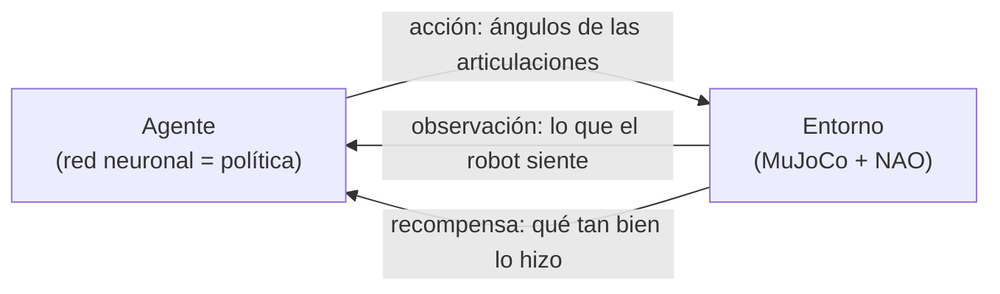

# Variables del aprendizaje por refuerzo en la caminata del NAO

> **Alcance (2026-10-10).** Este documento explica las variables de la **política del sprint inicial**: 43 observaciones,
> 10 o 12 acciones a 50 Hz, sin cámara y con el modelo V5. El diseño nuevo para la **carrera** está en
> [`plan_rl_carrera.md`](plan_rl_carrera.md):
>
> - 54 observaciones, que incluyen `d`, `psi` y válido de la cámara;
> - 13 acciones cada 24 ms;
> - faltas del reglamento en la recompensa;
> - fricción aleatoria.
>
> Los conceptos que se explican aquí siguen valiendo.

Este documento explica **qué variables intervienen** en el entrenamiento con el que el NAO aprendió a
caminar, **cuáles se usan, cuáles no y por qué**, y **qué cambiaría** si quisiéramos enseñarle otra
cosa, por ejemplo a saltar. No hace falta leer código ni fórmulas. Los conceptos siguen el
[curso de Deep RL de Hugging Face](https://huggingface.co/learn/deep-rl-course/unit0/introduction),
la [documentación de PPO de Stable-Baselines3](https://stable-baselines3.readthedocs.io/en/v2.2.1/modules/ppo.html)
y los [entornos MuJoCo de Gymnasium](https://gymnasium.farama.org/v1.1.0/environments/mujoco/) (lista
completa de fuentes al final).

---

## 1. La idea en un minuto

El aprendizaje por refuerzo es aprender **por prueba y error**: un *agente* (el "cerebro" del robot)
actúa dentro de un *entorno* (el simulador con el NAO), ve qué pasó y recibe una **recompensa**, un
número que dice qué tan bien lo hizo. El ciclo se repite millones de veces
([Unidad 1](https://huggingface.co/learn/deep-rl-course/unit1/introduction)):

- La **política** es "el cerebro del agente": la función que, dada la situación, decide qué hacer.
  Aquí es una red neuronal que empieza sin saber nada.
- La **hipótesis de la recompensa** dice que cualquier objetivo se puede expresar como "maximizar la
  recompensa acumulada". Por eso **diseñar la recompensa es diseñar el comportamiento**: el robot hace
  lo que se premia, no lo que uno tenía en mente.
- El robot no ve el mundo completo, solo un resumen de **49 números** (la *observación*). En términos
  del curso es un problema *parcialmente observado*: ve lo que sentiría con sus propios sensores, no el
  estado completo del simulador.

### ¿Qué fueron las "5 millones de pruebas"?

Son **5 millones de decisiones** (pasos), no 5 millones de caminatas. El robot decide 50 veces por
segundo, así que 5 millones de pasos equivalen a **unas 28 horas de experiencia simulada**, repartidas
en **unos 8,900 intentos** (episodios) de hasta 20 s. Con 16 robots simulados en paralelo, el
entrenamiento tomó **22 minutos** en un computador normal.

Así evolucionó la política entregada (datos del registro de entrenamiento):

| Momento del entrenamiento | Cuánto aguanta de pie | Qué está aprendiendo |
|---|---|---|
| Inicio (0 pasos) | ~1 s, siempre se cae | Mueve las piernas al azar |
| 250 mil pasos | ~2 s | A no caerse de inmediato |
| 500 mil pasos | ~17 s | A mantenerse de pie y dar los primeros pasos |
| 1 millón | ~20 s (casi nunca cae) | A avanzar a la velocidad pedida |
| 2 a 5 millones | 20 s, **0 caídas** | A caminar mejor: ritmo, suavidad, menos esfuerzo |

Primero aprende a **no caerse** y después a **caminar bien**. En la segunda mitad del entrenamiento no
se cae nunca, pero la recompensa sigue subiendo porque pule el estilo de la marcha.

---

## 2. Las seis familias de variables

No todas las "variables" juegan el mismo papel. Conviene separarlas en seis grupos:

| Familia | Quién la define | ¿El robot la controla? | Ejemplos |
|---|---|---|---|
| **1. Física del mundo** | El simulador (MuJoCo) y el modelo del robot | No | Gravedad, masas, fricción, fuerza máxima de los motores |
| **2. Observación** | Nosotros elegimos qué ve | No, solo la lee | Inclinación, giroscopio, ángulos, contacto de los pies |
| **3. Acción** | Nosotros elegimos qué puede mover | **Sí, es lo que decide** | Ángulo objetivo de caderas, rodillas, tobillos y hombros |
| **4. Recompensa** | Nosotros definimos cómo se califica | No, pero **aprende a maximizarla** | Premio por avanzar, castigo por inclinarse |
| **5. Reglas del episodio** | Nosotros | No | Cuándo se considera caída, duración máxima |
| **6. Parámetros del algoritmo (PPO)** | Nosotros | No | Cuánto le importa el futuro, cuánto explora |

### 2.1 Física del mundo: las variables que nadie decide durante el entrenamiento

Son las leyes del mundo simulado. El robot **no las observa como números**: sufre sus efectos. La
gravedad no aparece como un dato "9.81", pero si el robot se inclina demasiado, la gravedad lo tumba y
el episodio termina.

| Variable | Valor | Por qué importa para caminar |
|---|---|---|
| **Gravedad** | 9.81 m/s² hacia abajo (la de la Tierra) | Es lo que hace difícil caminar: todo el equilibrio consiste en no dejar que el peso lo tumbe |
| **Masa e inercia de cada pieza** | Datos oficiales del NAO (unos 5.4 kg en total) | Determinan cuánto cuesta mover cada parte y hacia dónde se va el peso |
| **Dimensiones y rangos articulares** | Datos oficiales del NAO | Qué posturas son físicamente posibles |
| **Fricción pie-suelo** | 1.0 (suelo con buen agarre) | Sin fricción, los pies resbalarían |
| **Fuerza máxima de cada motor** | Entre 1.3 y 3.3 N·m según la articulación | Limita qué tan rápido y fuerte puede moverse. Son motores pequeños |
| **Servomotores** | Siguen el ángulo pedido con una rigidez fija | Así funcionan los motores reales del NAO: reciben ángulos, no fuerzas |
| **Paso de simulación** | 2 ms (500 cálculos físicos por segundo) | Precisión de la física |

Estas variables **no cambian durante el entrenamiento**, así que la política aprende para *esta*
física en particular. Es una limitación conocida: si el robot real pesa distinto o el suelo es más
resbaloso, la política puede fallar. La solución habitual es la *aleatorización de dominio*: variar
masas, fricción, etc. en cada intento para que aprenda a caminar en todas esas condiciones.

### 2.2 Observación: lo que el robot "siente" (49 números)

Cada 20 ms la política recibe estos datos. Cada uno está elegido porque existe un sensor equivalente en
el NAO real o porque resuelve un problema concreto:

| Variable | Cantidad | Sensor equivalente en el NAO real | Por qué se usa |
|---|---|---|---|
| **Dirección de la gravedad vista desde el torso** | 3 | Unidad inercial (IMU) | Es la forma de "sentir" la gravedad: le dice cuánto y hacia dónde está inclinado. Es la variable más importante para no caerse |
| **Velocidad de giro del torso** | 3 | Giroscopio | Detecta que *empieza* a caerse antes de que la inclinación sea grande: permite reaccionar a tiempo |
| **Velocidad del torso** | 3 | No existe directamente (se estima) | Para saber si va a la velocidad pedida (0.2 m/s) |
| **Ángulo de cada articulación controlada** | 12 | Encoders de los motores | Conocer su propia postura |
| **Velocidad de cada articulación** | 12 | Encoders | Saber hacia dónde se está moviendo cada pierna |
| **Acción anterior** | 12 | Memoria del controlador | Los motores tardan en llegar al ángulo pedido. Recordar lo que ordenó ayuda a moverse con suavidad |
| **Contacto de cada pie con el suelo** | 2 | Sensores de presión en las plantas (FSR) | Saber qué pie está apoyado y cuál en el aire |
| **Reloj de marcha** | 2 | Ninguno (es un metrónomo interno) | Marca el ritmo: cada 0.6 s se completa un ciclo de paso izquierdo y derecho |

**Comparación útil:** en el ejercicio práctico de la Unidad 1, el
[LunarLander](https://huggingface.co/learn/deep-rl-course/unit1/hands-on) observa posición, velocidad,
ángulo, velocidad angular y **si cada pata toca el suelo**: casi la misma lista. Aterrizar una nave y
mantener un robot de pie son problemas de equilibrio parecidos.

Antes de entrar a la red, cada número se **normaliza** (se lleva a una escala comparable), como
recomienda la [Unidad 6](https://huggingface.co/learn/deep-rl-course/unit6/hands-on) con
`VecNormalize`: "una buena práctica en RL es normalizar las entradas". Sin esto, una velocidad
articular de 5 rad/s pesaría 100 veces más que una inclinación de 0.05, sin ser más importante.

### 2.3 Acción: lo que el robot decide (12 números)

Cada 20 ms la política elige **12 ángulos objetivo**, medidos como desviaciones desde la postura de pie:

| Articulación | Por lado | Para qué sirve al caminar |
|---|---|---|
| HipRoll (cadera, lateral) | 1 | Pasar el peso de un pie al otro |
| HipPitch (cadera, adelante/atrás) | 1 | Llevar la pierna hacia adelante (dar el paso) |
| KneePitch (rodilla) | 1 | Levantar el pie y amortiguar |
| AnklePitch (tobillo, adelante/atrás) | 1 | Empujar el suelo y ajustar el equilibrio |
| AnkleRoll (tobillo, lateral) | 1 | Equilibrio lateral |
| ShoulderPitch (hombro) | 1 | Balancear los brazos |

- Es un **espacio de acción continuo** (cualquier ángulo dentro de un rango), como el volante de un auto
  en el ejemplo de la Unidad 1, y no un menú de opciones como en un videojuego.
- **Se envían ángulos y no fuerzas.** El entorno Humanoid de Gymnasium manda fuerzas (torques)
  directamente. Aquí se usan ángulos porque así se controla el NAO real (NAOqi recibe ángulos): la
  marcha es más estable y es más fácil pasar después al robot físico.
- **Cada articulación tiene un rango máximo** (por ejemplo ±0.5 rad en rodilla y ±0.25 rad en cadera
  lateral), para que la exploración inicial, que es casi al azar, no lleve al robot a posturas extremas
  que lo tiren al suelo de inmediato.

### 2.4 Recompensa: cómo se califica cada instante

La recompensa se entrega **en cada paso** (recompensa *densa*), no solo al final. La Unidad 6 contrasta
ambas: con una recompensa escasa ("+1 si llegaste a la meta") el robot casi nunca recibiría una señal
útil al principio, porque se cae antes de lograr nada.

La recompensa total es la **suma de varios términos**. Cada uno premia o castiga algo concreto:

| Término | Peso | Qué pide | Por qué existe | Al inicio → al final* |
|---|---|---|---|---|
| **Velocidad de avance** | +1.0 | Avanzar a 0.2 m/s, ni más lento ni más rápido | Es el objetivo principal | 0.06 → **0.96** (máx. 1) |
| **Patrón de marcha** | +0.5 | Que cada pie apoye y se levante al ritmo del reloj | Sin un ritmo de referencia, nada le impide arrastrar los pies o avanzar a saltitos | 0.28 → **0.49** (máx. 0.5) |
| **Vivo** | +0.1 | Seguir de pie | Pequeño incentivo para no caerse | 0.10 → 0.10 |
| **Inclinación** | −2.0 | Torso erguido | Un torso inclinado es el preludio de una caída | −0.18 → −0.004 |
| **Altura** | −50 | Mantener el torso a ~31 cm | Evita que "camine" agachado, de rodillas o gateando | −0.007 → −0.007 |
| **Velocidad lateral** | −10 | No desviarse de lado | Caminar recto | −0.13 → −0.009 |
| **Velocidad de giro** | −0.5 | No girar sobre sí mismo | Caminar recto | −0.51 → −0.017 |
| **Cambio de acción** | −0.02 | No cambiar bruscamente de una orden a la siguiente | Movimientos suaves y sin vibración, que no dañen los motores reales | −0.06 → −0.014 |
| **Esfuerzo (torque)** | −0.001 | Usar poca fuerza | Ahorrar energía y no forzar los motores | −0.05 → −0.02 |
| **Caída** | −10 (una vez) | No caerse | Castigo fuerte al terminar por caída | −0.19 → **0** |

\* Valor medio por paso, ya multiplicado por su peso, al inicio y al final del entrenamiento de la
política entregada.

**Por qué tantos términos.** El robot aprovecha cualquier atajo que dé puntos, así que cada término
cierra una puerta:

- Premiar solo "avanzar lo más rápido posible" invita a lanzarse hacia adelante, que mueve el torso
  rápido aunque termine en caída. Por eso se premia una **velocidad objetivo**.
- Sin el castigo de **altura** nada le impediría bajar el torso y avanzar casi de rodillas, que es más
  estable.
- La primera versión caminaba con "pasitos de soldado" porque el reloj no dejaba nunca los dos pies
  apoyados a la vez. Cambiar una sola variable del reloj (que cada pie apoye el 60% del ciclo, con un 20%
  de doble apoyo) produjo una marcha más natural.
- El **balanceo de brazos** en oposición a las piernas **no se premió en ningún término**: la política lo
  descubrió sola porque le ayuda a equilibrarse, y el equilibrio sí da puntos.

**Comparación con los ejemplos del curso:**

| Idea | LunarLander (Unidad 1) | Humanoid (Gymnasium) | NAO (este proyecto) |
|---|---|---|---|
| Premio por la meta | Acercarse a la plataforma | Avanzar (peso 1.25) | Velocidad de avance (1.0) |
| Premio por "seguir vivo" | — | *healthy reward* (5.0) | Vivo (0.1) |
| Castigo por inclinarse | Sí | No (usa límites de altura) | Inclinación (−2.0) |
| Castigo por gastar energía | Encender motores (−0.03/−0.3) | *ctrl cost* (0.1) | Torque (−0.001) y cambio de acción (−0.02) |
| Castigo por fracasar | Estrellarse (−100) | Termina el episodio | Caída (−10) y termina el episodio |
| Contacto con el suelo | +10 por cada pata apoyada | Castigo por fuerzas de contacto | Patrón de marcha (qué pie apoya y cuándo) |

### 2.5 Reglas del episodio

| Regla | Valor | Por qué |
|---|---|---|
| **Inicio** | Postura de pie + pequeñas variaciones al azar (±0.02 rad) | Si siempre empezara igual, aprendería una sola secuencia de memoria. Gymnasium hace lo mismo (`reset_noise_scale`) |
| **Caída (fin del intento)** | Torso por debajo de 22 cm, inclinado más de 40°, o cualquier parte que no sea un pie tocando el suelo | No tiene sentido seguir entrenando en el suelo. Humanoid y Hopper usan reglas equivalentes de altura y ángulo |
| **Duración máxima** | 20 s (1000 decisiones), igual que en Gymnasium | Obliga a variar las situaciones y a empezar de nuevo |

En términos del curso es una **tarea episódica**: tiene inicio y fin, y cada intento es un episodio.

### 2.6 Parámetros del algoritmo PPO

**Cómo aprende, sin matemáticas.** PPO es un método *actor-crítico*
([Unidad 6](https://huggingface.co/learn/deep-rl-course/unit6/introduction)) con dos redes:

- El **actor** (la política) decide qué hacer.
- El **crítico** estima qué tan buena es la situación actual: "desde aquí, ¿cuánta recompensa espero?".

Después de cada ronda de experiencia se compara lo que pasó con lo que el crítico esperaba (la
*ventaja*). Las acciones que salieron **mejor de lo esperado se vuelven más probables** y las que
salieron peor, menos. Esa es la idea del *policy gradient* explicada en el
[video](https://www.youtube.com/watch?v=5P7I-xPq8u8). Lo propio de PPO es que **limita cuánto cambia la
política en cada ronda**, para no "olvidar" de golpe lo que ya funcionaba.

| Parámetro | Valor | Qué significa en palabras | Valor por defecto de SB3 |
|---|---|---|---|
| `gamma` (descuento) | 0.99 | Cuánto le importa el futuro. Con 0.99 "mira" unos 100 pasos, **unos 2 s hacia adelante**, suficiente para planear uno o dos pasos | 0.99 |
| `n_steps` × entornos | 512 × 16 = 8,192 | Cuánta experiencia junta antes de aprender de ella en cada ronda | 2,048 × 1 |
| `batch_size` | 2,048 | En qué trozos se reparte esa experiencia al aprender | 64 |
| `n_epochs` | 5 | Cuántas veces repasa cada ronda de experiencia | 10 |
| `learning_rate` | 0.0003 | Qué tan grandes son los ajustes en cada repaso | 0.0003 |
| `clip_range` | 0.2 | El freno de PPO: la política no puede cambiar más de ~20% por ronda | 0.2 |
| `gae_lambda` | 0.95 | Cuánto confiar en el crítico frente a lo que realmente pasó | 0.95 |
| Exploración inicial (`log_std_init`) | −1 | Cuánto "ruido" agrega a sus decisiones para probar cosas nuevas | 0 |
| `ent_coef` | 0.0 | Premio extra por explorar (no hizo falta) | 0.0 |
| Tamaño de la red | 2 capas de 256 neuronas | Capacidad del "cerebro" | 2 capas de 64 |

**Exploración contra explotación.** La [Unidad 1](https://huggingface.co/learn/deep-rl-course/unit1/exp-exp-tradeoff)
lo explica con restaurantes: ir siempre al conocido (explotar) o probar uno nuevo (explorar). Al
principio la política agrega un ruido de ±0.37 rad a sus decisiones para descubrir movimientos. A
medida que aprende, ella misma lo reduce, y al final del entrenamiento el ruido es de ±0.10 rad: ya sabe
lo que funciona y casi no experimenta.

---

## 3. Variables que NO se usan, y por qué

Tan importante como lo que se usa es lo que se deja fuera. Cada variable extra hace el problema más
difícil de aprender.

| Variable no usada | Por qué no |
|---|---|
| **Posición absoluta del robot (x, y)** | Caminar bien es igual en cualquier punto del piso. Gymnasium la excluye por defecto "para inducir un comportamiento independiente de la posición" |
| **Gravedad, masas e inercias como números** | Son constantes: nunca cambian, así que no le aportan información. El Humanoid de Gymnasium sí las incluye (130 números de masas e inercias), pero en una tarea con física fija no ayudan |
| **Altura del torso** | Se usa en la recompensa y en la regla de caída, pero no se observa: en el robot real no se mide directamente |
| **Fuerzas de contacto detalladas** | Basta saber si el pie toca el suelo o no. El Humanoid de Gymnasium usa 78 números de fuerzas de contacto |
| **Cámaras, micrófonos, sonar** | En suelo plano no hace falta ver. Las imágenes multiplicarían el tamaño del problema |
| **Temperatura de motores, batería** | No están modeladas en la simulación |
| **Cabeza, codos, muñecas y manos** | No aportan a la marcha: quedan fijos en su postura. Menos articulaciones = aprende más rápido |
| **HipYawPitch** (cadera en diagonal) | En el NAO un solo motor mueve las dos caderas a la vez. Sirve para girar, no para caminar recto, e inclinaba el torso durante la exploración, así que se dejó fija |
| **Comandos de velocidad o de giro** | La tarea es fija: caminar recto a 0.2 m/s. Por eso el robot no sabe detenerse ni girar |
| **Historial largo del pasado** | Por la *propiedad de Markov* (Unidad 1), basta con el estado actual. La acción anterior y el reloj cubren lo poco que hace falta recordar |

---

## 4. ¿Y si quisiéramos que salte?

Aquí se ve para qué sirve separar las variables en familias: **cambiar el comportamiento es cambiar
sobre todo la recompensa y las reglas**, mientras la física queda igual.

La **gravedad sigue siendo exactamente la misma** (9.81 m/s²), pero pasa de ser algo a equilibrar a ser
**el adversario principal**. Para despegar, las piernas tienen que empujar el suelo con más fuerza que
el peso del robot (unos 5.4 kg × 9.81 ≈ 53 N) durante una fracción de segundo. Con motores de 3 N·m como
máximo, la simulación mostraría de forma realista qué tan alto puede saltar un NAO, que es poco.

| Familia | Caminar (hoy) | Saltar (qué cambiaría) |
|---|---|---|
| **Física** | Gravedad 9.81, masas y motores del NAO | **Igual.** Sí importaría más modelar bien el impacto al aterrizar y los límites de los motores |
| **Observación** | Inclinación, giroscopio, velocidades, ángulos, contacto de pies, reloj de marcha | Agregar la **altura del torso** y destacar la **velocidad vertical** (subiendo o cayendo). El reloj de marcha sobra: se reemplaza por "tiempo desde el despegue" o se elimina |
| **Acción** | Caderas, rodillas, tobillos y hombros, con rangos cortos | Las mismas articulaciones con **más rango en rodillas y tobillos** para agacharse e impulsarse. Los brazos pueden ayudar a tomar impulso |
| **Recompensa** | Velocidad de avance, patrón de marcha alternado, castigo por cambiar de altura | **Quitar el castigo de altura** (hoy castiga justamente subir). **Quitar el patrón alternado** (en un salto los dos pies van juntos). **Premiar** la altura alcanzada, la velocidad hacia arriba o el tiempo con ambos pies en el aire. **Premiar aterrizar de pie** y quedar estable. **Castigar el impacto** fuerte al caer (como el *contact cost* del Humanoid) |
| **Reglas** | Caída si el torso baja de 22 cm | Revisar ese umbral: al agacharse para impulsarse no debe contar como caída. Que ambos pies estén en el aire ya no es raro, es el objetivo |
| **PPO** | `gamma` = 0.99 (mira ~2 s) | Probablemente igual: agacharse primero *baja* la recompensa inmediata pero habilita el salto un momento después, y 2 s de horizonte alcanzan para "entender" esa relación |

Un ejemplo real del mismo tipo es el entorno
[Hopper](https://gymnasium.farama.org/v1.1.0/environments/mujoco/hopper/) de Gymnasium: una pierna que
**avanza a saltos** con solo tres términos (premio por seguir sano, premio por avanzar y castigo por
esfuerzo) y reglas de altura y ángulo para detectar la caída. El salto no se programa: surge porque es
la forma que encuentra de avanzar.

### Otros ejemplos rápidos

| Si quisiéramos que… | Variable clave que cambia |
|---|---|
| **Corra** | Velocidad objetivo más alta y permitir que ambos pies estén en el aire a la vez (fase de vuelo) |
| **Gire o cambie de velocidad** | Agregar a la observación un **comando** de velocidad y giro que cambie en cada intento, y premiar seguirlo |
| **Se detenga juntando los pies** | Igual que el anterior, con velocidad 0 entre los comandos posibles |
| **Se levante del suelo** | Empezar acostado y premiar la altura del torso, como el entorno *HumanoidStandup* de Gymnasium |
| **Resista empujones** | Aplicar empujones al azar durante el entrenamiento (física) sin cambiar la recompensa |
| **Funcione en el robot real** | Aleatorizar la física (masas, fricción, retrasos de los motores, ruido de sensores) y quitar observaciones que el robot real no tiene, como la velocidad del torso |

---

## 5. Resumen

- **La física pone las reglas del juego**: gravedad, masas, motores. No se aprenden ni se observan
  como números, pero determinan todo lo demás.
- **La observación es lo que el robot siente**: 49 números elegidos para imitar sus sensores reales. La
  gravedad entra como *dirección* (inclinación), no como valor.
- **La acción es lo único que decide**: 12 ángulos, 50 veces por segundo.
- **La recompensa es cómo se le enseña**: define qué es "caminar bien", y el robot la sigue al pie de
  la letra, incluso buscando atajos.
- **Enseñar otra habilidad**, como saltar, correr o girar, consiste sobre todo en cambiar la
  recompensa, las reglas y a veces la observación. La física y el algoritmo casi no cambian.

---

## Fuentes

- Hugging Face, *Deep RL Course*: [Introducción](https://huggingface.co/learn/deep-rl-course/unit0/introduction),
  [Unidad 1: fundamentos](https://huggingface.co/learn/deep-rl-course/unit1/introduction),
  [Unidad 1: práctica con LunarLander y PPO](https://huggingface.co/learn/deep-rl-course/unit1/hands-on),
  [Unidad 6: actor-crítico y robótica](https://huggingface.co/learn/deep-rl-course/unit6/introduction).
- Stable-Baselines3, [PPO](https://stable-baselines3.readthedocs.io/en/v2.2.1/modules/ppo.html):
  parámetros y valores por defecto.
- Gymnasium, [entornos MuJoCo](https://gymnasium.farama.org/v1.1.0/environments/mujoco/): Humanoid y
  Hopper como referencia de observaciones, recompensas y reglas de caída.
- Video: [*An introduction to Policy Gradient methods*](https://www.youtube.com/watch?v=5P7I-xPq8u8).
- Datos del proyecto: [`src/envs/nao_walk_env.py`](../src/envs/nao_walk_env.py) (observación, acción,
  recompensa y reglas), [`configs/ppo_brazos.yaml`](../configs/ppo_brazos.yaml) (parámetros de la
  política entregada) y registros de entrenamiento de `ppo_brazos_5M`.
